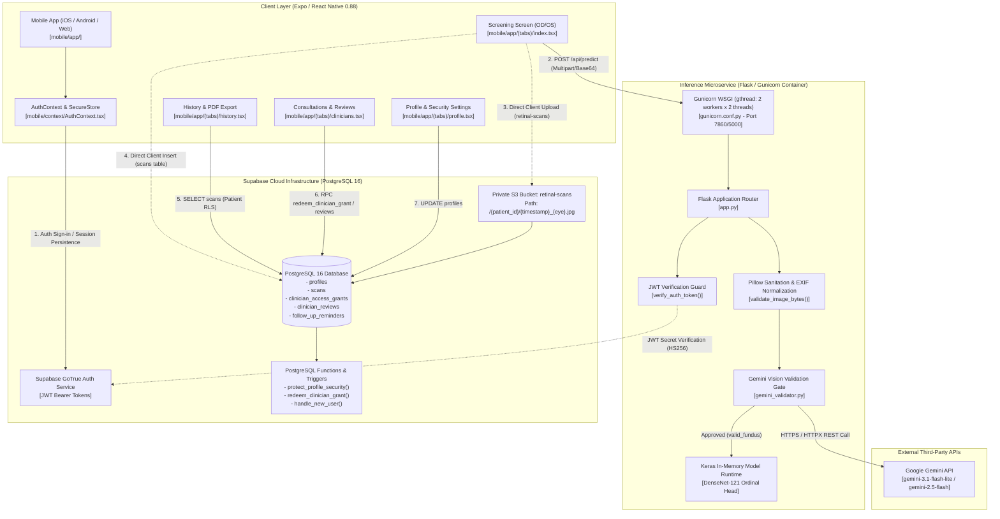
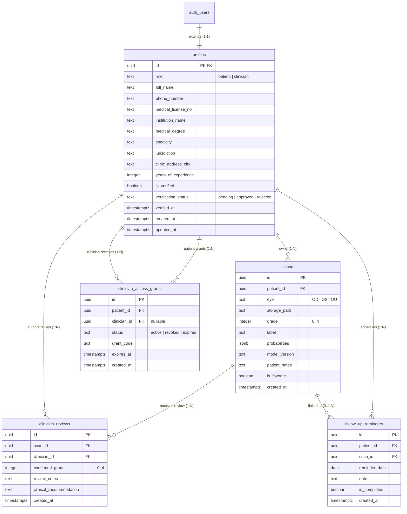
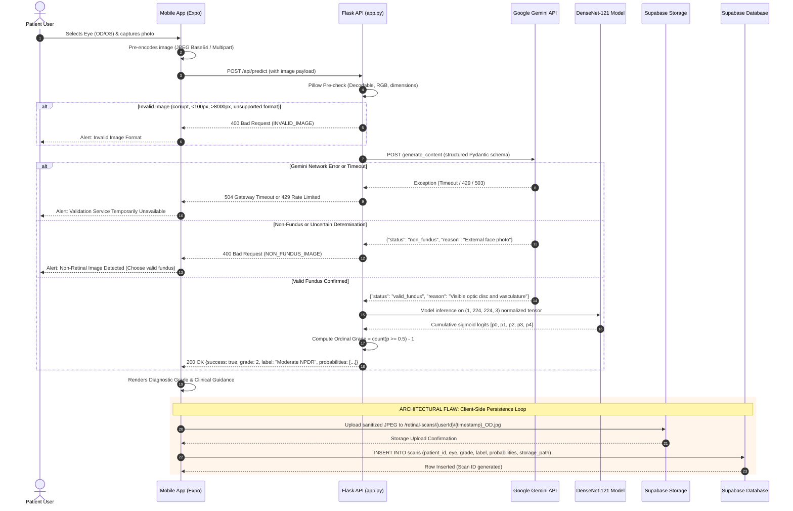
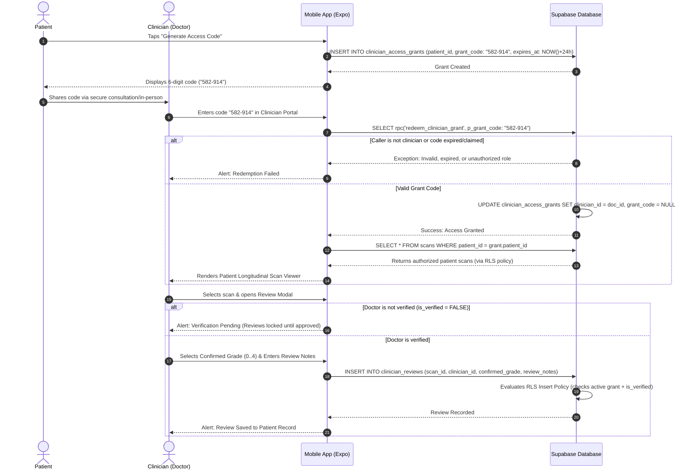
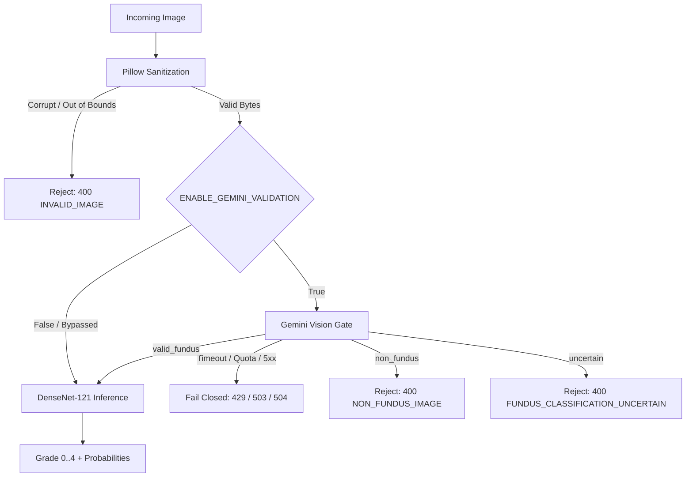

# System Architecture Audit & Technical Blueprint

**Project:** Diabetic Retinopathy Diagnostic System (AI Clinical Screening Platform)  
**Audit Author:** Agent 1 (Application Architect)  
**Date:** November 22, 2026  
**Scope:** Complete End-to-End System Architecture (Flask Backend, DenseNet-121 / RETFound Artifacts, Supabase Migrations & RLS, Expo Mobile App, Containerization, and Cloud Integrations)  
**Audit Status:** Completed — Phase 1 (Audit Only)

---

## 1. Executive Summary

This architecture audit evaluates the complete technical foundation of the Diabetic Retinopathy Diagnostic System, a hybrid mobile-cloud AI screening platform designed for automated grading of diabetic retinopathy (DR) from digital retinal fundus photography (ICDRS Grades 0 to 4).

The platform comprises four primary operational pillars:
1. **Inference Microservice**: A Python 3.12 Flask service (`app.py`, `gemini_validator.py`) serving an ordinal classification deep learning model packaged as `retfound_model.keras`, preceded by a server-side Gemini 3.1 Flash-Lite modality validation gate.
2. **Mobile Client Application**: An Expo SDK 58 / React Native 0.88 cross-platform application (`mobile/`) written in TypeScript, featuring Expo Router file-based navigation, role-based interfaces (Patient vs. Clinician), clinical PDF report generation, and biometrics.
3. **Managed Cloud Backend**: Supabase PostgreSQL 16 providing identity management, Row Level Security (RLS) policies, patient-delegated clinician access grants, clinical second opinion reviews, and private S3-compatible object storage (`retinal-scans`).
4. **Model Artifacts & Training Lineage**: Deep learning artifacts including `retfound_model.keras` (82.3 MB), `retfound_model.tflite` (29.0 MB), training evaluation histories (`history.json`, `retfound_history.json`), and an exploratory Jupyter notebook (`85.ipynb`).

### Overall Architectural Posture
The core diagnostic pipeline demonstrates strong baseline design principles, specifically regarding its **fail-closed pre-screening validation gate** (Gemini vision filter rejecting non-retinal images before inference) and **strict database-level privilege escalation triggers** (PostgreSQL BEFORE triggers preventing self-verification or role promotion). 

However, several critical structural weaknesses and architectural discrepancies were identified:
- **Two-Headed Backend / Client-Side Persistence Vulnerability**: The mobile client communicates directly with Flask for inference and independently with Supabase for data persistence. The mobile client is entrusted to record the AI diagnostic result into the database, creating a severe integrity loophole where a modified client can forge diagnostic grades.
- **Model Identity & Artifact Dissonance**: While model files and documentation refer to "RETFound" (a Foundation ViT architecture by Moorfields/UCL), the active architecture is a standard convolutional **DenseNet-121** with an ordinal regression output head.
- **Unused Edge Inference Artifact**: A quantized `retfound_model.tflite` (29.0 MB) exists in the repository but is completely disconnected from the mobile runtime, forcing all inference over cellular/Wi-Fi to the central Flask container.
- **CORS & Environment Inconsistencies**: Permissive wildcard CORS (`*`) coupled with `supports_credentials=True`, unauthenticated Flask development fallback when `SUPABASE_JWT_SECRET` is unset, and internal container port discrepancies (`7860` vs `5000`).
- **Dead & Incomplete Modules**: Unused boilerplate screens (`two.tsx`, generic `modal.tsx`), an unexercised `follow_up_reminders` database table, and a root-level script (`test_supabase.py`) that breaks root `pytest` test collection during DNS/offline conditions.

---

## 2. System Topology & Architectural Map

The following diagram illustrates the complete runtime topology, protocol boundaries, data flows, and external integration points:



---

## 3. Component Inventory & Module Mapping

### 3.1 Backend Inference Service
| Component / File | Purpose & Responsibilities | Upstream Dependencies | Downstream Dependencies |
| :--- | :--- | :--- | :--- |
| `app.py` | Primary WSGI entry point, HTTP router, web portal SSR, request parsing, and inference controller | Flask, flask-cors, PyJWT, TensorFlow, Pillow | `gemini_validator.py`, `retfound_model.keras` |
| `gemini_validator.py` | Technical image pre-screening triage gate; validates file headers, EXIF orientation, dimensions, and performs multimodal LLM classification | Pillow, Pydantic, google-genai, httpx | Google Gemini API |
| `gunicorn.conf.py` | Production WSGI process manager configuration; defines concurrency (`2` workers x `2` threads), worker class (`gthread`), memory isolation | Python standard library | `app:create_app()` |
| `Dockerfile` | Multi-layer container build based on `python:3.12-slim`; provisions non-root `appuser` (UID 1000), system libraries (`libglib2.0-0`, `libgomp1`), and healthcheck | Docker base image | Container runtimes (Docker, Cloud Run) |
| `docker-compose.yml` | Local and staging container orchestration with memory ceiling (2500 MB) and CPU reservation | Dockerfile | Local Docker Daemon |

### 3.2 Machine Learning Pipeline
| Asset / File | Format & Specifications | Architectural Role | Operational Status |
| :--- | :--- | :--- | :--- |
| `retfound_model.keras` | Keras v3 / H5 archive (82.3 MB). Input: `(None, 224, 224, 3)`. Backbone: DenseNet-121. Output: 5 cumulative sigmoid probabilities. | Active production inference model used by `app.py`. | **Active** |
| `retfound_model.tflite` | Quantized TensorFlow Lite flatbuffer (29.0 MB). | Edge inference model intended for on-device mobile execution. | **Disconnected** (Never referenced in `mobile/` or `app.py`). |
| `85.ipynb` | Jupyter Notebook containing exploratory data analysis, Kaggle pipeline references, and model prototyping. | Model development history and experimentation artifact. | **Archival** |
| `history.json` | Training epoch logs for baseline DenseNet model (`accuracy`, `loss`, `val_accuracy`, `val_loss`, `val_kappa`). | Metric validation and training lineage reference. | **Static Reference** |
| `retfound_history.json` | 15-epoch training logs with ordinal threshold metrics (`val_exact_grade_accuracy`, `val_kappa` up to 0.9578). | Diagnostic validation reference. | **Static Reference** |

### 3.3 Mobile Application (Expo / React Native)
| File / Directory | Module Category | Key Architectural Responsibilities |
| :--- | :--- | :--- |
| `mobile/app/_layout.tsx` | App Root & Navigation Guard | Global layout wrapper, splash screen synchronization, Google font loading, and `RootNavigationGuard` redirecting unauthenticated users to `(auth)/login`. |
| `mobile/context/AuthContext.tsx` | State & Persistence | Global React context wrapping Supabase Auth; manages session state, user profile retrieval from `public.profiles`, SecureStore-backed settings, and token refresh. |
| `mobile/lib/supabase.ts` | Backend SDK Client | Configures Supabase JS client with `ExpoSecureStoreAdapter` (and web `localStorage` fallback) and exposes `INFERENCE_API_URL`. |
| `mobile/app/(auth)/login.tsx` | Authentication UI | Form validation for user login, error handling for unconfirmed emails, and navigation to registration. |
| `mobile/app/(auth)/register.tsx` | Authentication UI | Multi-step role-based registration form (Patient vs. Clinician); captures medical qualifications, license numbers, jurisdictions, and clinic locations. |
| `mobile/app/(tabs)/_layout.tsx` | Navigation Tabs | Dynamic 4-tab bar layout (Screening, History, Clinicians/Consultations, Settings) with role-adaptive titles and icons. |
| `mobile/app/(tabs)/index.tsx` | Core Screening Interface | Target eye selection (OD/OS), camera/gallery image picker (`expo-image-picker`), multipart/base64 HTTP POST to Flask API, diagnosis display, and direct Supabase DB/storage persistence. |
| `mobile/app/(tabs)/history.tsx` | Longitudinal Tracking | Paginated history of past scans, eye-specific filtering (OD/OS/ALL), and A4 clinical PDF report generation via `expo-print` and `expo-sharing`. |
| `mobile/app/(tabs)/clinicians.tsx` | Clinical Collaboration | Dual-mode screen: Patients generate and revoke 6-digit delegation codes; Clinicians redeem codes via RPC and submit formal second-opinion reviews. |
| `mobile/app/(tabs)/profile.tsx` | Profile & Security | Profile editing modal, biometrics screen lock toggle, encrypted cache toggle, model architecture inspection, and GDPR data export/deletion requests. |
| `mobile/app/(tabs)/two.tsx` | Dead Boilerplate Screen | Unused Expo starter screen, disabled via `href: null` in `_layout.tsx`. |
| `mobile/app/modal.tsx` | Unimplemented Modal | Boilerplate modal screen placeholder referencing starter template components. |

### 3.4 Database Schema & Storage
| Database Object | Type | Definition & Architectural Scope |
| :--- | :--- | :--- |
| `public.profiles` | Table | Extends `auth.users`; stores user role (`patient`, `clinician`), medical credentials, clinic addresses, and verification statuses (`pending`, `approved`, `rejected`). |
| `public.scans` | Table | Primary clinical entity; stores `patient_id`, eye designation (`OD`, `OS`, `OU`), image `storage_path`, ordinal `grade` (0..4), diagnostic `label`, cumulative `probabilities` (JSONB), and `model_version`. |
| `public.clinician_access_grants` | Table | Access delegation table; maps patient to clinician with a time-limited `expires_at` timestamp and one-time `grant_code`. |
| `public.clinician_reviews` | Table | Official clinician second opinions; stores `confirmed_grade`, `review_notes`, and `clinical_recommendation`. Requires clinician to be verified. |
| `public.follow_up_reminders` | Table | Automated patient reminder tracking (`reminder_date`, `is_completed`). |
| `retinal-scans` | Storage Bucket | Private Supabase object storage bucket restricted by RLS to user-scoped folder paths (`auth.uid() = foldername[1]`). |
| `trg_protect_profile_security` | DB Trigger | Executes `public.protect_profile_security()` BEFORE INSERT/UPDATE on `profiles` to block client-side privilege escalation. |
| `redeem_clinician_grant` | DB Function (RPC) | Security Definer function allowing authenticated clinicians to redeem a valid delegation code. |

---

## 4. API Surface & Contract Mapping

The system exposes two primary interface surfaces: the **Flask Inference Service** and the **Supabase PostgREST & Auth API**.

### 4.1 Flask Inference API Specifications
Base URL: `http://localhost:5000` (Dev) / `http://localhost:7860` (Docker default)

```
┌────────────────────────────────────────────────────────────────────────────────────────┐
│                              FLASK INFERENCE SERVICE                                    │
├───────────────┬─────────┬───────────────────┬───────────────────┬──────────────────────┤
│ Endpoint      │ Method  │ Auth Required     │ Content-Type      │ Success Response     │
├───────────────┼─────────┼───────────────────┼───────────────────┼──────────────────────┤
│ /             │ GET     │ None (Public)     │ text/html         │ 200 HTML Portal      │
│ /predict      │ POST    │ None (Public)     │ multipart/form    │ 200 HTML Result      │
│ /api/health   │ GET     │ None (Public)     │ application/json  │ 200 Health Status    │
│ /api/predict  │ POST    │ Optional Bearer   │ multipart or json │ 200 Prediction JSON  │
└───────────────┴─────────┴───────────────────┴───────────────────┴──────────────────────┘
```

#### Detailed Endpoint Analysis

#### 1. `GET /api/health`
- **Request Headers**: None
- **Response Status**: `200 OK`
- **Response Schema**:
  ```json
  {
    "status": "healthy",
    "model_loaded": true,
    "model_version": "densenet121_ordinal_v1",
    "auth_enforced": false,
    "gemini_validation_enabled": true,
    "gemini_configured": true
  }
  ```
- **Architectural Notes**: Returns operational telemetry including model loading status and whether Gemini validation is actively enabled and configured with an API key.

#### 2. `POST /api/predict`
- **Request Headers**:
  - `Content-Type`: `multipart/form-data` OR `application/json`
  - `Authorization`: `Bearer <SUPABASE_JWT>` *(Optional; enforced only if `SUPABASE_JWT_SECRET` is defined in server environment)*
  - `Bypass-Tunnel-Reminder`: `true` *(Sent by mobile client to bypass development tunneling interstitial banners)*
- **Payload Options**:
  - **Option A (Multipart)**: Form field `image` or `file` containing raw JPEG/PNG bytes (Max: 10 MB).
  - **Option B (JSON Base64)**: `{"image": "data:image/jpeg;base64,..."}` or raw base64 string.
- **Success Response (`200 OK`)**:
  ```json
  {
    "success": true,
    "grade": 2,
    "label": "Moderate non-proliferative diabetic retinopathy",
    "probabilities": [0.9842, 0.9125, 0.7410, 0.1235, 0.0211],
    "model_version": "densenet121_ordinal_v1",
    "validation": {
      "status": "valid_fundus",
      "reason": "Retinal fundus photograph showing optic disc, retinal vasculature, and macula.",
      "bypassed": false
    }
  }
  ```
- **Error Responses**:
  - `400 Bad Request (INVALID_IMAGE)`: Missing file, corrupted bytes, dimensions < 100x100 or > 8000x8000, or unsupported format.
  - `400 Bad Request (NON_FUNDUS_IMAGE)`: Pre-screening gate rejected image as non-retinal (e.g., selfie, external eye, pet, chart).
  - `400 Bad Request (FUNDUS_CLASSIFICATION_UNCERTAIN)`: Image too dark, blurred, or degraded to verify retinal landmarks.
  - `401 Unauthorized`: Provided JWT is invalid, expired, or missing when `SUPABASE_JWT_SECRET` is configured.
  - `413 Payload Too Large`: Uploaded image exceeds 10 MB limit.
  - `429 Too Many Requests (GEMINI_RATE_LIMITED)`: Google Gemini API quota or rate limit exceeded.
  - `500 Internal Server Error (GEMINI_CONFIGURATION_ERROR)`: Validation gate enabled but `GEMINI_API_KEY` is missing from server.
  - `503 Service Unavailable (GEMINI_VALIDATION_UNAVAILABLE)`: Gemini upstream network or connection error.
  - `504 Gateway Timeout (GEMINI_TIMEOUT)`: Gemini validation exceeded timeout threshold (`GEMINI_TIMEOUT_SECONDS=15`).

---

## 5. Database Schema & Data Integrity Architecture

The Supabase PostgreSQL database enforces data models across three sequential schema migrations (`001_initial_schema.sql`, `002_rls_and_profile_fixes.sql`, `003_doctor_registration_and_roles.sql`).



### 5.1 Row-Level Security (RLS) & Access Control Matrix

| Database Entity | Operation | Permitted Actor / Condition | Enforcement Mechanism |
| :--- | :--- | :--- | :--- |
| `profiles` | `SELECT` | Profile owner (`auth.uid() = id`) OR verified clinicians (`role = 'clinician' AND is_verified = TRUE`) | RLS Policy |
| `profiles` | `INSERT` | Self registration (`auth.uid() = id`) | RLS Policy + Trigger Defaults |
| `profiles` | `UPDATE` | Self update (`auth.uid() = id`). Protected fields (`role`, `is_verified`, `verification_status`) locked to old values unless called by `service_role`. | RLS Policy + `protect_profile_security()` |
| `scans` | `SELECT` | Scan owner (`auth.uid() = patient_id`) OR active authorized clinician with valid, unexpired grant (`EXISTS clinician_access_grants`) | RLS Policy |
| `scans` | `INSERT / UPDATE / DELETE` | Strictly the patient owner (`auth.uid() = patient_id`) | RLS Policy |
| `clinician_access_grants` | `SELECT` | Grant patient owner (`auth.uid() = patient_id`) OR assigned clinician (`auth.uid() = clinician_id`) | RLS Policy |
| `clinician_access_grants` | `UPDATE` | Clinician claiming unclaimed active grant with matching code via RPC or direct update | RLS Policy + RPC `redeem_clinician_grant` |
| `clinician_reviews` | `SELECT` | Scan patient owner (`scans.patient_id = auth.uid()`) OR reviewing clinician (`clinician_id = auth.uid()`) | RLS Policy |
| `clinician_reviews` | `INSERT` | Clinician with active unexpired grant AND verified credential status (`is_verified = TRUE`) | RLS Policy |
| `storage.objects` (`retinal-scans`) | `INSERT / SELECT` | Patient uploading to own user-scoped directory (`auth.uid()::text = foldername[1]`) OR authorized clinician with active grant | Supabase Storage RLS Policies |

---

## 6. End-to-End Data Flows & Sequence Traces

### 6.1 Clinical Eye Screening & Inference Sequence
The diagram below details the end-to-end journey when a patient captures and analyzes a retinal photograph:



### 6.2 Clinician Delegation & Second Opinion Sequence
The diagram below details how patient data access is delegated to clinicians and how second-opinion reviews are persisted:



---

## 7. Deep-Dive Architectural Weaknesses & Risks

### Issue Matrix Summary
| ID | Severity | Category | Architectural Finding | Primary Impact |
| :--- | :--- | :--- | :--- | :--- |
| **ARCH-01** | **CRITICAL** | Integrity / Trust Model | Client-Side Scan Record Persistence | Malicious/tampered clients can forge diagnostic records |
| **ARCH-02** | **HIGH** | Security / Auth | Unauthenticated Flask Dev Mode Fallback | API quota exhaustion & unauthenticated ML execution |
| **ARCH-03** | **HIGH** | Nomenclature / Design | Model Identity Mismatch (DenseNet vs RETFound) | System confusion & incorrect clinical documentation |
| **ARCH-04** | **MEDIUM** | Performance / Edge | Unused TFLite Model Artifact | High bandwidth consumption; no offline screening |
| **ARCH-05** | **MEDIUM** | Security / Network | Permissive Wildcard CORS with Credentials | Potential cross-origin credential leakage |
| **ARCH-06** | **MEDIUM** | Feature Gap | Absence of Grad-CAM / Attention Heatmaps | Black-box AI output; zero visual explainability |
| **ARCH-07** | **LOW** | Code Hygiene | Dead Screens & Boilerplate Remnants | Bloated bundle; incomplete user experience |
| **ARCH-08** | **LOW** | DevOps / Config | Port Number Inconsistencies (`7860` vs `5000`) | Potential deployment orchestration mismatch |
| **ARCH-09** | **LOW** | Testing Hygiene | Root-level `test_supabase.py` crashes `pytest` | Flaky CI test collection without network connection |

---

### Detailed Architectural Analysis

#### ARCH-01: Two-Headed Architecture & Client-Side Scan Record Persistence
- **Location**: `mobile/app/(tabs)/index.tsx` (Lines 184–228)
- **Description**: The mobile application operates across two independent backends without an orchestrating API Gateway:
  1. The client calls Flask `/api/predict` to receive an AI grade.
  2. The client then independently calls `supabase.storage.from('retinal-scans').upload()` and `supabase.from('scans').insert()`.
- **Architectural Risk**:
  - **Forged Medical Records**: Because the Supabase RLS policy allows patients to insert rows into `scans` matching `auth.uid() = patient_id`, an attacker or compromised mobile client can directly submit arbitrary grades, labels, and probability vectors directly to Supabase without ever running inference or uploading a valid fundus image.
  - **Divergent State on Network Interruption**: If the network drops immediately after receiving the Flask prediction response but before Supabase upload completes, the patient is shown an AI diagnosis on-screen, but no record is persisted to their longitudinal medical history.
- **Remediation Recommendation**: Invert the flow or implement an authenticated backend gateway:
  - The client uploads the image to Supabase Storage first or submits the image to an authenticated backend route.
  - The backend verifies the image, executes inference, and writes the verified result to `scans` using the service role key or an authenticated database function, returning the canonical scan ID to the client.

#### ARCH-02: Unauthenticated Flask Development Fallback
- **Location**: `app.py` (`verify_auth_token()`, Lines 178–199)
- **Description**:
  ```python
  def verify_auth_token():
      secret = os.environ.get("SUPABASE_JWT_SECRET")
      if not secret:
          # Development mode: auth check bypassed if no secret configured
          return True, None
  ```
- **Architectural Risk**: If `SUPABASE_JWT_SECRET` is omitted from the deployment environment (which is the default in `.env.example` and `docker-compose.yml`), the API completely disables authentication. Anyone with network access to the API can execute arbitrary predictions, directly consuming upstream Google Gemini API credits and GPU/CPU compute cycles.
- **Remediation Recommendation**: Enforce authentication by default in production. Introduce an explicit `REQUIRE_AUTH=true` flag or raise a startup error if `SUPABASE_JWT_SECRET` is missing when `FLASK_ENV=production`.

#### ARCH-03: Model Architecture Nomenclature Mismatch
- **Location**: Repository root (`retfound_model.keras`), `README.md`, `app.py` (`MODEL_VERSION = "densenet121_ordinal_v1"`)
- **Description**: The repository filenames and documentation conflate two fundamentally different AI architectures:
  - **RETFound** is a 300M+ parameter Vision Transformer (ViT-Large) foundation model developed specifically for retinal images by Moorfields Eye Hospital and UCL (published in *Nature*, 2023).
  - The actual deployed model in `retfound_model.keras` is a standard convolutional **DenseNet-121** model fine-tuned for ordinal classification.
- **Architectural Risk**:
  - Regulatory and clinical compliance risk: Documenting a model as RETFound while serving DenseNet-121 constitutes mislabeling of medical AI software.
  - Disconnects training logs and model governance documentation.
- **Remediation Recommendation**: Standardize naming across repository documentation, code constants, and artifact files to accurately reflect the DenseNet-121 ordinal classifier, or complete the intended migration to the genuine RETFound ViT backbone.

#### ARCH-04: Disconnected TFLite Model & Missing Edge Inference Pipeline
- **Location**: `retfound_model.tflite` (28.9 MB)
- **Description**: A fully converted TensorFlow Lite model (`retfound_model.tflite`) exists in the repository root. However, neither `mobile/` nor `app.py` references or executes this artifact.
- **Architectural Risk**:
  - Mobile screening currently requires continuous network connectivity and round-trip server latency (~1.5s–3s).
  - Retinal screening is frequently deployed in low-connectivity community or rural environments where on-device TFLite inference via `react-native-fast-tflite` or native modules would provide immediate offline capability.
- **Remediation Recommendation**: Evaluate adding an optional on-device inference path in the mobile app using `retfound_model.tflite` for offline screening when central connectivity is unavailable.

#### ARCH-05: Insecure CORS Configuration
- **Location**: `app.py` (Line 206)
- **Description**:
  ```python
  CORS(app, resources={r"/api/*": {"origins": "*"}}, supports_credentials=True)
  ```
- **Architectural Risk**: Modern web security standards (W3C CORS specification) explicitly disallow combining wildcard `origins: "*"` with `supports_credentials: True`. While standard mobile clients (iOS/Android) ignore CORS policies, web clients (`mobile/` targeting web) may encounter browser console rejections or cross-origin security exposure.
- **Remediation Recommendation**: Replace wildcard origins with an environment-configurable origin whitelist:
  ```python
  allowed_origins = os.environ.get("ALLOWED_ORIGINS", "*").split(",")
  CORS(app, resources={r"/api/*": {"origins": allowed_origins}}, supports_credentials=True)
  ```

#### ARCH-06: Absence of Model Explainability / Grad-CAM Heatmaps
- **Location**: `app.py`, `mobile/app/(tabs)/index.tsx`
- **Description**: The application provides an ordinal grade (0–4) and cumulative threshold probabilities, but contains no visual explainability or feature attribution maps (such as Grad-CAM).
- **Architectural Risk**: In clinical ophthalmology screening, clinicians evaluating an AI recommendation require visual localization of microaneurysms, hemorrhages, or neovascularization to substantiate the algorithm's grade. A pure numeric output limits clinical adoption.
- **Remediation Recommendation**: Implement a Grad-CAM generation utility targeting the final convolutional layer of DenseNet-121 (`conv5_block16_concat`), returning an overlaid heatmap PNG or coordinate bounding boxes along with the prediction payload.

#### ARCH-07: Unused Boilerplate Screens & Dead Code
- **Location**:
  - `mobile/app/(tabs)/two.tsx` (Unused boilerplate starter tab)
  - `mobile/app/modal.tsx` (Boilerplate screen referencing `EditScreenInfo`)
  - `follow_up_reminders` (Database table defined in `001_initial_schema.sql` but never referenced in frontend)
- **Architectural Risk**: Dead code increases maintenance surface area and produces inconsistent UX (e.g. clicking "Clinical Screening Guidelines" modal opens a placeholder screen).
- **Remediation Recommendation**: Safely remove `two.tsx`, replace `modal.tsx` with genuine clinical screening guidelines content, and either integrate `follow_up_reminders` into the UI or archive the table migration.

#### ARCH-08: Container Port Configuration Drift
- **Location**: `Dockerfile` (`EXPOSE 7860`), `gunicorn.conf.py` (`PORT=7860`), `docker-compose.yml` (`5000:5000`, `PORT=5000`), `app.py` (`PORT=5000`), `DEPLOYMENT.md`
- **Description**: The Dockerfile specifies port `7860` (standard for Hugging Face Spaces), while `docker-compose.yml`, `app.py`, and local developer configurations default to port `5000`.
- **Architectural Risk**: Configuration mismatches can cause health checks or reverse proxies to fail when moving containers across different deployment targets (e.g. local Docker vs Google Cloud Run vs HF Spaces).
- **Remediation Recommendation**: Standardize environment port handling across all deployment descriptors using a single consistent default (`PORT=5000`).

#### ARCH-09: Root Test Execution Collision
- **Location**: `test_supabase.py` (Repository root)
- **Description**: `test_supabase.py` is located in the project root rather than inside `tests/` or a `scripts/` directory. Because its filename begins with `test_`, executing `pytest` at the root automatically collects it. The script contains top-level executable code that calls `exit(1)` when network/DNS fails, aborting the entire pytest test run.
- **Remediation Recommendation**: Relocate `test_supabase.py` to `scripts/diagnostics/test_supabase.py` or wrap its procedural code inside an `if __name__ == '__main__':` block.

---

## 8. Duplication & Coupling Analysis

### 8.1 Image Validation Duplication
- **Observation**: Image dimension checks and format validation are duplicated between `gemini_validator.py` (`validate_image_bytes`) and the client-side `expo-image-picker` configuration in `mobile/app/(tabs)/index.tsx`.
- **Assessment**: This form of defensive duplication is beneficial in mobile architectures: client-side checks provide immediate feedback and reduce unnecessary uploads, while server-side checks strictly guard inference compute and prevent spoofing.

### 8.2 Design Token & Color Duplication
- **Observation**: Clinical severity grades and visual color badges are defined independently in two places:
  1. `mobile/constants/Colors.ts` (`SeverityColors`)
  2. `app.py` (Inline CSS in `PAGE` template)
- **Assessment**: Low severity, but changes to clinical grading display logic must be manually synchronized between the web fallback UI and the mobile application.

### 8.3 Tight Schema Coupling in Mobile Client
- **Observation**: `mobile/app/(tabs)/clinicians.tsx` and `mobile/app/(tabs)/index.tsx` execute direct PostgREST queries against table names (`scans`, `clinician_access_grants`, `profiles`) and exact column names.
- **Assessment**: Any breaking database column rename in future migrations will immediately break mobile clients in the field unless managed via database views or stored procedures.

---

## 9. Operational & Deployment Architecture

### 9.1 Container Resource Profile
- **Gunicorn Worker Model**: Process model configured with `worker_class = "gthread"` (2 workers x 2 threads).
- **Preload App Setting**: `preload_app = False`. This is an essential architectural decision for TensorFlow deployments, as loading a Keras model prior to process forking causes CUDA/CPU thread lockups in child workers.
- **Memory Footprint**: Each TensorFlow CPU worker allocates approximately 600 MB–800 MB RAM upon model loading. With 2 workers and Gunicorn master, the container requires a minimum of 1.8 GB RAM. The `docker-compose.yml` memory limit of 2500 MB is well-sized for stability.

### 9.2 Reliability & Fallback Strategies

- **Fail-Closed Gate**: The validation gate enforces a strict "fail-closed" security policy. If Gemini experiences rate-limiting, timeouts, or API outages, the service refuses to guess or pass images blind to the DenseNet model. This prevents non-retinal images from receiving false diagnoses during service degradation.
- **Feature Flag Bypass**: When necessary for air-gapped or offline development, setting `ENABLE_GEMINI_VALIDATION=false` safely bypasses the Gemini gate without modifying source code.

---

## 10. Prioritized Architectural Recommendations

### Phase 2 Implementation Roadmap

#### Priority 1: Critical Security & Integrity (Milestone 1)
1. **Invert Scan Persistence (Close ARCH-01)**:
   - Transition scan recording to a server-side verified operation. Provide a dedicated backend endpoint or Supabase Edge Function that receives the image, validates it, runs inference, uploads to storage, and writes the canonical scan row to PostgreSQL.
2. **Mandate Authentication in Production (Close ARCH-02)**:
   - Ensure `SUPABASE_JWT_SECRET` is strictly validated on startup when running in container/production mode.

#### Priority 2: Correctness & Explainability (Milestone 2)
1. **Resolve Model Identity Dissonance (Close ARCH-03)**:
   - Update model version labels and documentation to consistently state "DenseNet-121 Ordinal Classifier" throughout the codebase.
2. **Implement Grad-CAM Explainability (Close ARCH-06)**:
   - Add a Grad-CAM generation function in `app.py` returning visual attention heatmaps to improve clinician trust.
3. **Restrict CORS Origins (Close ARCH-05)**:
   - Configure explicit origin domain matching in `CORS()`.

#### Priority 3: Cleanliness, Performance & Developer Experience (Milestone 3)
1. **Clean Dead Code (Close ARCH-07)**:
   - Delete `mobile/app/(tabs)/two.tsx` and implement proper clinical content in `mobile/app/modal.tsx`.
2. **Relocate Root Diagnostic Scripts (Close ARCH-09)**:
   - Move `test_supabase.py` into a `scripts/` directory to preserve clean `pytest` test collection.
3. **Standardize Deployment Port (Close ARCH-08)**:
   - Unify container ports to `5000` across `Dockerfile`, `docker-compose.yml`, and `gunicorn.conf.py`.
4. **Explore Offline Edge Screening (Close ARCH-04)**:
   - Prototype integration of `retfound_model.tflite` into the mobile app for offline community screening.

---

## 11. Conclusion & Audit Sign-Off

The Diabetic Retinopathy Diagnostic System demonstrates a well-conceived core design with robust defensive gating at the API boundary and strong database-level role security. Addressing the two-headed backend persistence loop, naming dissonance, and CORS configuration in Phase 2 will elevate the architecture to enterprise-grade clinical readiness.

**Audit Completed By:** Agent 1 (Application Architect)  
**Report Artifact:** `audit/02_architecture_audit.md`  
**Status:** Complete — Proceeding to Board Sign-Off
