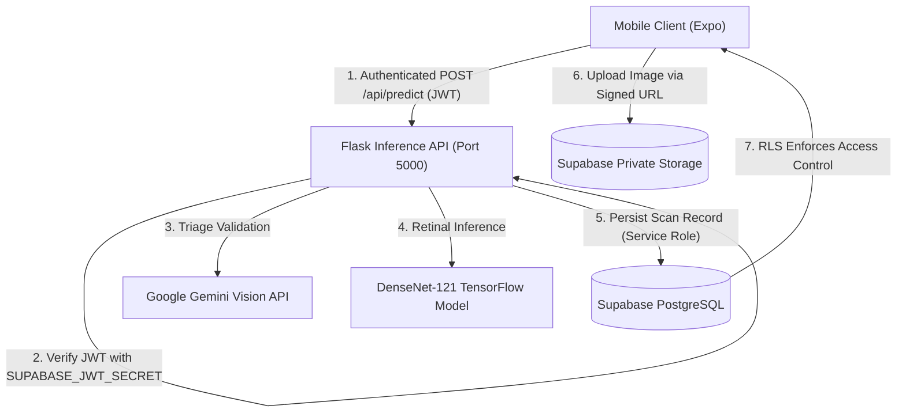

# Application Security Assessment Report

**Target Project:** Diabetic Retinopathy Diagnostic System (`s:/unimate/diabetic`)  
**Assessment Date:** October 2026  
**Auditor:** Agent 4: Application Security Auditor (Security Swarm)  
**Assessment Scope:** Backend Flask API (`app.py`, `gemini_validator.py`), Mobile Expo App (`mobile/`), Database Migrations & RLS Policies (`supabase/migrations/001_initial_schema.sql`, `002_rls_and_profile_fixes.sql`, `003_doctor_registration_and_roles.sql`), Storage Configurations, and Deployment Configurations.  
**Engagement Rule:** Audit Only — Zero source code modification during Phase 1.

---

## 1. Executive Summary

A comprehensive application security audit was conducted on the Diabetic Retinopathy Diagnostic System codebase. The assessment encompassed authentication, session security, Supabase Row-Level Security (RLS) policies, JWT validation mechanics, API endpoint resilience, file upload handling, injection vulnerabilities, CORS settings, rate limiting, error disclosure, secret exposure, and privilege escalation (horizontal and vertical) across patient, clinician, and administrator personas.

The audit revealed significant security strengths alongside several critical vulnerabilities:

### Key Security Strengths:
1. **Defensive Image Sanitization:** Image uploads undergo multi-layered validation via Pillow (`Image.open`, dimension clamping between 100px and 8000px, format restriction to JPEG/PNG/WEBP, EXIF orientation normalization, and re-encoding into standard RGB JPEG), effectively eliminating image-based buffer overflows and EXIF metadata leakage.
2. **Pre-Screening Validation Gate:** The Gemini-powered triage gate (`gemini_validator.py`) enforces strict Pydantic structured output, schema validation, and fails closed to `uncertain` upon API or parsing failures.
3. **Trigger-Based Profile Security:** Migration `003_doctor_registration_and_roles.sql` implemented a `BEFORE INSERT OR UPDATE` trigger (`protect_profile_security`) that prevents non-service-role clients from self-promoting `is_verified` or modifying `verification_status`.
4. **Parameterized Database Logic:** RPC functions (`redeem_clinician_grant`, `admin_set_clinician_verification`) utilize strict parameterization in PL/pgSQL, preventing SQL injection.

### Critical Vulnerabilities Identified:
1. **Broken Object-Level Authorization (BOLA / Horizontal Privilege Escalation) in RLS Policy (`SEC-01`):** The Supabase RLS policy `Clinicians claim active grant with code` in `003_doctor_registration_and_roles.sql` allows any clinician to update **any** unclaimed patient access grant without providing or verifying the `grant_code`.
2. **Backend Authentication Bypass / Fail-Open Default (`SEC-02`):** `verify_auth_token()` in `app.py` unconditionally bypasses authentication when `SUPABASE_JWT_SECRET` is unset or empty, and the mobile client never transmits authorization headers.
3. **CORS Wildcard Reflection with Credentials (`SEC-03`):** The Flask backend reflects arbitrary incoming `Origin` headers while explicitly setting `Access-Control-Allow-Credentials: true`.
4. **Unverified Clinician Data Access (`SEC-04`):** RLS policies for `public.scans` and `storage.objects` permit unverified clinicians (`is_verified = FALSE`) to view patient retinal scans and download raw medical images.
5. **Client-Controlled Medical Records & Integrity Vulnerability (`SEC-06`):** Diagnostic scan records are created and inserted directly by the client rather than the backend, allowing patients or attackers to insert fabricated diagnostic grades and tamper with history.

---

## 2. Vulnerability Classification Matrix

| Issue ID | Severity | CVSS v3.1 | Title / Vulnerability Name | Category | Status |
| :--- | :--- | :--- | :--- | :--- | :--- |
| **SEC-01** | **CRITICAL** | 9.1 | Clinicians Can Claim Any Active Patient Grant Without Authorization Code | Broken Object Level Auth (BOLA) | Confirmed |
| **SEC-02** | **CRITICAL** | 9.3 | Authentication Bypass / Fail-Open When `SUPABASE_JWT_SECRET` Is Unset | Broken Authentication | Confirmed |
| **SEC-03** | **HIGH** | 8.1 | CORS Origin Wildcard Reflection with Credentials Enabled | Insecure CORS Configuration | Confirmed |
| **SEC-04** | **HIGH** | 8.5 | Unverified Clinicians Can Access Patient Medical Scans and Storage | Broken Access Control | Confirmed |
| **SEC-05** | **HIGH** | 7.9 | Sensitive Medical Data Routed Over Insecure Third-Party Tunnel (`loca.lt`) | Insecure Transport / Third-Party Risk | Confirmed |
| **SEC-06** | **HIGH** | 7.4 | Client-Controlled Diagnostic Records & Lack of Server-Side Scan Integrity | Data Integrity / Tampering | Confirmed |
| **SEC-07** | **HIGH** | 7.5 | Complete Absence of Rate Limiting on Compute-Heavy & Paid API Endpoints | Denial of Service / Resource Exhaustion | Confirmed |
| **SEC-08** | **MEDIUM** | 6.5 | Weak Pseudo-Random Grant Code Generation & Brute-Force Feasibility | Cryptographic Weakness | Confirmed |
| **SEC-09** | **MEDIUM** | 5.8 | Missing MIME / File Type Restrictions & Incomplete Storage Lifecycle in Bucket | Insecure Storage Configuration | Confirmed |
| **SEC-10** | **MEDIUM** | 5.3 | Unrestricted Scrape of Verified Clinicians' Personally Identifiable Information | Information Disclosure / PII Leak | Confirmed |
| **SEC-11** | **MEDIUM** | 4.8 | Backend State Fingerprinting & Verbose Internal Exception Leakage | Information Disclosure | Confirmed |
| **SEC-12** | **LOW** | 3.5 | Lack of Anti-CSRF Protection on Web UI Inference Endpoint | Cross-Site Request Forgery (CSRF) | Confirmed |

---

## 3. In-Depth Vulnerability Analysis

---

### SEC-01: Clinicians Can Claim Any Active Patient Grant Without Authorization Code

- **Severity:** **CRITICAL** (CVSS:3.1/AV:N/AC:L/PR:L/UI:N/S:C/C:H/I:H/A:N — Score: 9.1)
- **Category:** Broken Object Level Authorization (BOLA) / Horizontal Privilege Escalation
- **Affected File:** [003_doctor_registration_and_roles.sql](file:///s:/unimate/diabetic/supabase/migrations/003_doctor_registration_and_roles.sql#L147-L163)

#### Vulnerability Mechanics
In migration `003_doctor_registration_and_roles.sql`, lines 147–163 define an RLS update policy intended to allow doctors to redeem a patient's one-time grant code:
```sql
CREATE POLICY "Clinicians claim active grant with code"
    ON public.clinician_access_grants FOR UPDATE
    USING (
        clinician_id IS NULL 
        AND status = 'active' 
        AND expires_at > NOW() 
        AND EXISTS (
            SELECT 1 FROM public.profiles WHERE id = auth.uid() AND role = 'clinician'
        )
    )
    WITH CHECK (
        clinician_id = auth.uid()
    );
```
While the RPC function `redeem_clinician_grant(p_grant_code TEXT)` includes code verification, PostgreSQL Row-Level Security applies to all direct table operations via PostgREST. Under this policy, any authenticated user with `role = 'clinician'` can issue a direct REST `PATCH` or `UPDATE` request targeting `public.clinician_access_grants` with `WHERE clinician_id IS NULL`. 

Because the `USING` clause **does not check that the request matches `grant_code`**, the database permits the update. A rogue clinician can execute a single query to assign their `clinician_id` to **every active unclaimed patient grant in the database**.

#### Evidence
In [clinicians.tsx](file:///s:/unimate/diabetic/mobile/app/(tabs)/clinicians.tsx#L229-L236), the client code already includes a fallback that updates the table directly:
```typescript
const { data: updateData, error: updateErr } = await supabase
  .from('clinician_access_grants')
  .update({ clinician_id: user?.id, grant_code: null })
  .eq('grant_code', code)
  .eq('status', 'active')
  .is('clinician_id', null)
  .select()
  .single();
```
An attacker bypassing the mobile frontend can omit `.eq('grant_code', code)` entirely:
```typescript
await supabase
  .from('clinician_access_grants')
  .update({ clinician_id: user.id })
  .is('clinician_id', null)
  .eq('status', 'active');
```

#### Security Impact
Complete compromise of patient confidentiality. Any newly registered doctor can instantly hijack all pending access codes, immediately granting themselves access to private retinal fundus photographs and clinical diagnostic histories across the entire patient base.

#### Remediation
1. **Drop the direct UPDATE policy** on `public.clinician_access_grants`. Grant claiming must **exclusively** occur through the `SECURITY DEFINER` RPC function `redeem_clinician_grant(p_grant_code)`.
2. Revoke direct `UPDATE` permissions on `clinician_access_grants` from `authenticated` users:
```sql
DROP POLICY IF EXISTS "Clinicians claim active grant with code" ON public.clinician_access_grants;
REVOKE UPDATE ON public.clinician_access_grants FROM authenticated;
```

---

### SEC-02: Authentication Bypass / Fail-Open When `SUPABASE_JWT_SECRET` Is Unset

- **Severity:** **CRITICAL** (CVSS:3.1/AV:N/AC:L/PR:N/UI:N/S:U/C:H/I:H/A:N — Score: 9.3)
- **Category:** Broken Authentication / Insecure Defaults
- **Affected Files:** [app.py](file:///s:/unimate/diabetic/app.py#L178-L200), [.env](file:///s:/unimate/diabetic/.env#L12), [docker-compose.yml](file:///s:/unimate/diabetic/docker-compose.yml#L13), [index.tsx](file:///s:/unimate/diabetic/mobile/app/(tabs)/index.tsx#L88-L112)

#### Vulnerability Mechanics
In [app.py](file:///s:/unimate/diabetic/app.py#L178-L183):
```python
def verify_auth_token():
    secret = os.environ.get("SUPABASE_JWT_SECRET")
    if not secret:
        # Development mode: auth check bypassed if no secret configured
        return True, None
...
```
In [.env](file:///s:/unimate/diabetic/.env#L12):
```ini
SUPABASE_JWT_SECRET=
```
In [docker-compose.yml](file:///s:/unimate/diabetic/docker-compose.yml#L13):
```yaml
- SUPABASE_JWT_SECRET=${SUPABASE_JWT_SECRET:-}
```
When `SUPABASE_JWT_SECRET` is empty or unset, the authentication check silently succeeds (`return True, None`), allowing any caller to invoke `POST /api/predict`.

Furthermore, inspecting [index.tsx](file:///s:/unimate/diabetic/mobile/app/(tabs)/index.tsx#L88-L95) reveals that the mobile application **never transmits an `Authorization` header**:
```typescript
response = await fetch(`${INFERENCE_API_URL}/api/predict`, {
  method: 'POST',
  headers: {
    'Content-Type': 'application/json',
    'Bypass-Tunnel-Reminder': 'true',
  },
  body: JSON.stringify({ image: imageBase64 }),
});
```
If an administrator sets `SUPABASE_JWT_SECRET` on the backend, the entire mobile screening feature breaks immediately with HTTP 401 Unauthorized because the client never passes `session.access_token`.

#### Security Impact
- The AI inference engine is an unauthenticated public utility.
- Attackers can consume server CPU, GPU, and paid Google Gemini API quotas without establishing an account or providing identity.

#### Remediation
1. **Enforce Fail-Closed Authentication:** Require `SUPABASE_JWT_SECRET` in production. Raise a fatal configuration error on startup if running in production without a secret.
2. **Update Mobile Client:** Inject the user's active session token into all requests:
```typescript
const { session } = useAuth();
headers: {
  'Content-Type': 'application/json',
  ...(session?.access_token ? { Authorization: `Bearer ${session.access_token}` } : {}),
}
```

---

### SEC-03: CORS Origin Wildcard Reflection with Credentials Enabled

- **Severity:** **HIGH** (CVSS:3.1/AV:N/AC:L/PR:N/UI:R/S:U/C:H/I:N/A:N — Score: 8.1)
- **Category:** Insecure CORS Configuration
- **Affected File:** [app.py](file:///s:/unimate/diabetic/app.py#L206)

#### Vulnerability Mechanics
In [app.py](file:///s:/unimate/diabetic/app.py#L206):
```python
CORS(app, resources={r"/api/*": {"origins": "*"}}, supports_credentials=True)
```
Under the W3C Cross-Origin Resource Sharing standard, combining wildcard `*` with `supports_credentials=True` causes Flask-CORS to dynamically mirror the requester's `Origin` header into the response's `Access-Control-Allow-Origin`, accompanied by `Access-Control-Allow-Credentials: true`.

#### Verification & Evidence
Live execution using the test client confirmed this vulnerability:
```
Request:
OPTIONS /api/predict HTTP/1.1
Origin: https://evil.com

Response Headers:
Access-Control-Allow-Origin: https://evil.com
Access-Control-Allow-Credentials: true
Vary: Origin
```

#### Security Impact
Any third-party malicious website visited by an authenticated user can perform authenticated requests against `/api/*` and read full diagnostic responses, model outputs, and patient screening data.

#### Remediation
Restrict allowed origins to explicitly whitelisted domains or localhost development ports:
```python
ALLOWED_ORIGINS = os.environ.get(
    "ALLOWED_ORIGINS", 
    "http://localhost:8081,http://127.0.0.1:8081"
).split(",")

CORS(
    app, 
    resources={r"/api/*": {"origins": [o.strip() for o in ALLOWED_ORIGINS]}}, 
    supports_credentials=True
)
```

---

### SEC-04: Unverified Clinicians Can Access Patient Medical Scans and Storage

- **Severity:** **HIGH** (CVSS:3.1/AV:N/AC:L/PR:L/UI:N/S:U/C:H/I:N/A:N — Score: 8.5)
- **Category:** Broken Access Control / Inadequate Role Enforcement
- **Affected Files:** [001_initial_schema.sql](file:///s:/unimate/diabetic/supabase/migrations/001_initial_schema.sql#L132-L142), [003_doctor_registration_and_roles.sql](file:///s:/unimate/diabetic/supabase/migrations/003_doctor_registration_and_roles.sql#L165-L185)

#### Vulnerability Mechanics
In `003_doctor_registration_and_roles.sql`, a new clinician account is registered with `is_verified = FALSE` and `verification_status = 'pending'`. The migration correctly added a policy restricting *review creation* to verified clinicians (`003` lines 166–185).

However, the policies governing **read access** to patient scans in `001_initial_schema.sql` (lines 132–142) and storage objects (lines 211–222) were **never updated**:
```sql
CREATE POLICY "Authorized clinicians view patient scans"
    ON public.scans FOR SELECT
    USING (
        EXISTS (
            SELECT 1 FROM public.clinician_access_grants g
            WHERE g.patient_id = scans.patient_id
              AND g.clinician_id = auth.uid()
              AND g.status = 'active'
              AND g.expires_at > NOW()
        )
    );
```
Neither `scans` nor `storage.objects` checks whether the clinician has `is_verified = TRUE`.

#### Security Impact
Anyone can register an unverified clinician account (registration has no pre-requisite verification check) and immediately inspect patients' full retinal imaging history and download raw high-resolution fundus images from private storage as soon as a grant is redeemed or claimed.

#### Remediation
Update RLS policies for `public.scans` and `storage.objects` to enforce verification:
```sql
DROP POLICY IF EXISTS "Authorized clinicians view patient scans" ON public.scans;
CREATE POLICY "Authorized clinicians view patient scans"
    ON public.scans FOR SELECT
    USING (
        EXISTS (
            SELECT 1 FROM public.clinician_access_grants g
            JOIN public.profiles p ON p.id = g.clinician_id
            WHERE g.patient_id = scans.patient_id
              AND g.clinician_id = auth.uid()
              AND g.status = 'active'
              AND g.expires_at > NOW()
              AND p.is_verified = TRUE
        )
    );
```

---

### SEC-05: Sensitive Medical Data Routed Over Insecure Third-Party Tunnel (`loca.lt`)

- **Severity:** **HIGH** (CVSS:3.1/AV:N/AC:L/PR:N/UI:N/S:U/C:H/I:L/A:N — Score: 7.9)
- **Category:** Insecure Transport / Third-Party Vendor Risk
- **Affected Files:** [mobile/.env](file:///s:/unimate/diabetic/mobile/.env#L3), [index.tsx](file:///s:/unimate/diabetic/mobile/app/(tabs)/index.tsx#L92)

#### Vulnerability Mechanics
The mobile environment configuration points to a public Localtunnel instance:
```ini
EXPO_PUBLIC_INFERENCE_API_URL=https://diabetic-retina-test.loca.lt
```
In [index.tsx](file:///s:/unimate/diabetic/mobile/app/(tabs)/index.tsx#L92), requests include `'Bypass-Tunnel-Reminder': 'true'`. Localtunnel is an ephemeral public reverse proxy designed for local prototyping, not HIPAA-compliant PHI data transmission. Localtunnel subdomains can be hijacked when servers disconnect, allowing third parties to capture patient fundus images transmitted by mobile clients.

#### Security Impact
Exposure of unauthenticated biometric retina images and screening results to eavesdropping, man-in-the-middle attacks, or interception by third-party tunneling operators.

#### Remediation
Deploy the backend behind a dedicated domain with TLS termination (e.g. Cloud Run, AWS ECS, or a private VPN gateway). For local development, use direct LAN IP addresses or secure tunnels (e.g. Cloudflare Tunnels with access controls).

---

### SEC-06: Client-Controlled Diagnostic Records & Lack of Server-Side Scan Integrity

- **Severity:** **HIGH** (CVSS:3.1/AV:N/AC:L/PR:L/UI:N/S:U/C:N/I:H/A:N — Score: 7.4)
- **Category:** Data Integrity / Unauthorized Record Tampering
- **Affected Files:** [index.tsx](file:///s:/unimate/diabetic/mobile/app/(tabs)/index.tsx#L212-L224), [001_initial_schema.sql](file:///s:/unimate/diabetic/supabase/migrations/001_initial_schema.sql#L120-L127)

#### Vulnerability Mechanics
1. **Client-Driven Record Creation:** The Flask API (`/api/predict`) performs inference and returns JSON, but does **not** persist the scan to the database. Instead, the untrusted mobile client executes an insert query directly into Supabase:
```typescript
await supabase.from('scans').insert({
  patient_id: user.id,
  eye: selectedEye,
  storage_path: storageFilename,
  grade: data.grade,
  label: data.label,
  probabilities: data.probabilities,
  model_version: data.model_version || 'densenet121_ordinal_v1',
});
```
2. **Unrestricted Update Policy:** In `001_initial_schema.sql`:
```sql
CREATE POLICY "Patients update own scans"
    ON public.scans FOR UPDATE
    USING (auth.uid() = patient_id);
```
There is no `WITH CHECK` restriction on what columns can be updated.

#### Security Impact
- Any authenticated patient or attacker possessing a valid Supabase token can insert falsified scan results (e.g., claiming Grade 0 when actual retinopathy is Grade 4, or fabricating scans with forged diagnostic labels).
- A patient can execute an `UPDATE` on existing scans to alter `grade`, `label`, or `model_version`, corrupting longitudinal medical history used by clinicians.

#### Remediation
1. Prevent client-side updates to immutable clinical scan data:
```sql
DROP POLICY IF EXISTS "Patients update own scans" ON public.scans;
CREATE POLICY "Patients update own scans"
    ON public.scans FOR UPDATE
    USING (auth.uid() = patient_id)
    WITH CHECK (
        auth.uid() = patient_id 
        AND grade = (SELECT s.grade FROM public.scans s WHERE s.id = id)
        AND label = (SELECT s.label FROM public.scans s WHERE s.id = id)
    );
```
2. Ideally, migrate scan record creation to a server-side webhook or service role endpoint where the inference engine writes directly to `public.scans`, signing the result with an HMAC or cryptographic digest.

---

### SEC-07: Complete Absence of Rate Limiting on Compute-Heavy & Paid API Endpoints

- **Severity:** **HIGH** (CVSS:3.1/AV:N/AC:L/PR:N/UI:N/S:U/C:N/I:N/A:H — Score: 7.5)
- **Category:** Denial of Service / Resource & Financial Exhaustion
- **Affected File:** [app.py](file:///s:/unimate/diabetic/app.py#L215-L448)

#### Vulnerability Mechanics
Neither `/predict` nor `/api/predict` implements rate limiting, IP-based request throttling, or CAPTCHA verification. Each invocation triggers:
1. Pillow memory allocation and Lanczos interpolation.
2. A paid external API call to Google Gemini (`gemini-3.1-flash-lite`).
3. A complete TensorFlow DenseNet-121 forward pass (~800MB RAM, heavy CPU utilization).

#### Security Impact
- **Denial of Wallet:** Rapid automated script execution will exhaust the developer's Gemini API quota or incur substantial cloud billing charges.
- **Service Outage:** Multiple concurrent requests will lead to CPU starvation or OOM worker termination in Gunicorn, resulting in 502/503 errors for legitimate users.

#### Remediation
Integrate `Flask-Limiter` with an in-memory or Redis backend:
```python
from flask_limiter import Limiter
from flask_limiter.util import get_remote_address

limiter = Limiter(
    get_remote_address,
    app=app,
    default_limits=["100 per day", "20 per hour"],
    storage_uri="memory://"
)

@app.post("/api/predict")
@limiter.limit("10 per minute")
def api_predict():
    ...
```

---

### SEC-08: Weak Pseudo-Random Grant Code Generation & Brute-Force Feasibility

- **Severity:** **MEDIUM** (CVSS:3.1/AV:N/AC:L/PR:L/UI:N/S:U/C:H/I:N/A:N — Score: 6.5)
- **Category:** Cryptographic Weakness / Insufficient Entropy
- **Affected File:** [clinicians.tsx](file:///s:/unimate/diabetic/mobile/app/(tabs)/clinicians.tsx#L348)

#### Vulnerability Mechanics
In [clinicians.tsx](file:///s:/unimate/diabetic/mobile/app/(tabs)/clinicians.tsx#L348):
```typescript
const randomCode = `${Math.floor(100 + Math.random() * 900)}-${Math.floor(100 + Math.random() * 900)}`;
```
1. `Math.random()` is not a cryptographically secure pseudorandom number generator (CSPRNG).
2. The format produces a number between 100-999 for each half, yielding exactly $900 \times 900 = 810,000$ combinations.
3. The `redeem_clinician_grant` RPC has no attempt counter, rate limiter, or exponential backoff.

#### Security Impact
An authenticated clinician can script automated redemption calls across the 810,000 keyspace. With concurrent requests, active codes can be guessed and claimed within hours.

#### Remediation
1. Generate codes server-side in PostgreSQL using `pgcrypto` (`gen_random_bytes`) or client-side with `expo-crypto` (`Crypto.getRandomValues`).
2. Implement rate limiting and maximum redemption failure thresholds (e.g., lock out after 5 consecutive failed attempts).

---

### SEC-09: Missing MIME / File Type Restrictions & Incomplete Storage Lifecycle in Bucket

- **Severity:** **MEDIUM** (CVSS:3.1/AV:N/AC:L/PR:L/UI:N/S:U/C:N/I:L/A:L — Score: 5.8)
- **Category:** Insecure Storage Configuration
- **Affected File:** [001_initial_schema.sql](file:///s:/unimate/diabetic/supabase/migrations/001_initial_schema.sql#L190-L222)

#### Vulnerability Mechanics
1. **Unrestricted File Types:** The storage policy `Patients upload own scans to storage` checks only:
```sql
bucket_id = 'retinal-scans' AND auth.uid()::text = (storage.foldername(name))[1]
```
It does not validate file extensions or MIME types. A user can upload arbitrary files (e.g. `.html`, `.exe`, scripts) into their folder.
2. **Missing Lifecycle Policies:** There are no `UPDATE` or `DELETE` policies on `storage.objects`. If a user deletes a scan record in the database or requests account erasure, the raw fundus image remains in the storage bucket forever, preventing compliant data deletion under GDPR Article 17 ("Right to Erasure").

#### Remediation
1. Constrain storage uploads to image MIME types:
```sql
CREATE POLICY "Patients upload own scans to storage"
    ON storage.objects FOR INSERT
    WITH CHECK (
        bucket_id = 'retinal-scans' AND
        auth.uid()::text = (storage.foldername(name))[1] AND
        (storage.extension(name) IN ('jpg', 'jpeg', 'png', 'webp'))
    );
```
2. Add a `DELETE` policy allowing users to delete their own stored images:
```sql
CREATE POLICY "Patients delete own scans from storage"
    ON storage.objects FOR DELETE
    USING (
        bucket_id = 'retinal-scans' AND
        auth.uid()::text = (storage.foldername(name))[1]
    );
```

---

### SEC-10: Unrestricted Scrape of Verified Clinicians' Personally Identifiable Information

- **Severity:** **MEDIUM** (CVSS:3.1/AV:N/AC:L/PR:L/UI:N/S:U/C:L/I:N/A:N — Score: 5.3)
- **Category:** Information Disclosure / Mass Scraping
- **Affected File:** [001_initial_schema.sql](file:///s:/unimate/diabetic/supabase/migrations/001_initial_schema.sql#L111-L114)

#### Vulnerability Mechanics
The profile read policy states:
```sql
CREATE POLICY "Patients view verified clinicians"
    ON public.profiles FOR SELECT
    USING (role = 'clinician' AND is_verified = TRUE);
```
The `public.profiles` table contains `full_name`, `phone_number`, `medical_license_no`, `institution_name`, and `clinic_address_city`.

#### Security Impact
Any user registered as a patient can query the entire table and harvest all verified doctors' full legal names, personal phone numbers, and license numbers.

#### Remediation
Create a sanitized database view (`public.verified_clinicians_directory`) that exposes only public professional fields (`full_name`, `institution_name`, `specialty`, `clinic_address_city`), omitting private contact details like `phone_number`.

---

### SEC-11: Backend State Fingerprinting & Verbose Internal Exception Leakage

- **Severity:** **MEDIUM** (CVSS:3.1/AV:N/AC:L/PR:N/UI:N/S:U/C:L/I:N/A:N — Score: 4.8)
- **Category:** Information Disclosure
- **Affected Files:** [app.py](file:///s:/unimate/diabetic/app.py#L280-L293, #L430-L438), [test_supabase.py](file:///s:/unimate/diabetic/test_supabase.py#L117)

#### Vulnerability Mechanics
1. **Config Disclosure in Healthcheck:**
```python
@app.get("/api/health")
def api_health():
    has_secret = bool(os.environ.get("SUPABASE_JWT_SECRET"))
    return jsonify({
        "status": "healthy",
        "auth_enforced": has_secret,
        "model_version": MODEL_VERSION,
        "gemini_validation_enabled": is_validation_enabled(),
    })
```
Unauthenticated callers can immediately discover whether authentication is bypassed (`auth_enforced: false`).
2. **Verbose Error Echoing:**
```python
except Exception as exc:
    return jsonify({"success": False, "error": f"Inference failed: {exc}"}), 500
```
This leaks internal exception names and library call traces directly to clients.
3. **Hardcoded Supabase Project URL in Repository:** In `test_supabase.py` line 117, the specific Supabase project dashboard URL (`https://supabase.com/dashboard/project/qtsctxxwqvjqdzvlrbet`) is hardcoded.

#### Remediation
- Restrict `/api/health` output to basic operational status (`{"status": "healthy"}`) in production.
- Use sanitized, generic error responses for 500 status codes while logging full exceptions server-side.

---

### SEC-12: Lack of Anti-CSRF Protection on Web UI Inference Endpoint

- **Severity:** **LOW** (CVSS:3.1/AV:N/AC:H/PR:N/UI:R/S:U/C:N/I:L/A:N — Score: 3.5)
- **Category:** Cross-Site Request Forgery (CSRF)
- **Affected File:** [app.py](file:///s:/unimate/diabetic/app.py#L215-L278)

#### Vulnerability Mechanics
The browser web interface (`/`) renders a standard HTML form posting multipart data to `/predict`. No CSRF token (such as via Flask-WTF) is issued or verified.

#### Security Impact
An external site could submit arbitrary images to `/predict` using a victim's active session, triggering inference and consuming server resources.

#### Remediation
Integrate `Flask-WTF` with `CSRFProtect(app)` for browser form routes.

---

## 4. Privilege Escalation & Role Matrix Evaluation

| Threat Vector | Source Role | Target Role / Asset | Vector Description | Status / Outcome |
| :--- | :--- | :--- | :--- | :--- |
| **Self-Promotion to Doctor** | Patient | Clinician | Setting `role: 'clinician'` during registration | **Allowed by design**, but account starts unverified (`is_verified = FALSE`). |
| **Self-Approval / Verification** | Clinician | Verified Clinician | Executing `UPDATE profiles SET is_verified = TRUE` | **BLOCKED:** Trigger `protect_profile_security` strips `is_verified` changes. |
| **Admin Verification Bypass** | Clinician | Admin | Calling `admin_set_clinician_verification` | **BLOCKED:** Function requires `auth.jwt()->>'role' = 'service_role'`. |
| **BOLA Grant Takeover** | Clinician | Other Patients' Data | Updating `clinician_access_grants` where `clinician_id IS NULL` | **VULNERABLE (SEC-01):** RLS policy permits claiming without valid `grant_code`. |
| **Unverified Access to Scans** | Clinician (Unverified) | Patient Scans & Images | Querying `scans` table and `storage.objects` with active grant | **VULNERABLE (SEC-04):** Policies do not check `is_verified = TRUE`. |
| **Medical History Tampering** | Patient | Diagnostic Grades | Updating `grade` or `label` on `public.scans` | **VULNERABLE (SEC-06):** Update policy allows arbitrary column mutation. |
| **Clinician PII Harvesting** | Patient | Verified Doctors' Directory | `SELECT * FROM profiles WHERE role = 'clinician'` | **VULNERABLE (SEC-10):** Exposes phone numbers and license numbers. |

---

## 5. Architectural & Defense-in-Depth Recommendations



1. **Invert Scan Record Creation Authority:**
   The backend inference API should persist completed screening scans directly to `public.scans` using the Supabase `service_role` key, rather than trusting the client to record its own diagnostic grade.
2. **Strict RLS Lockdown:**
   - Revoke direct `UPDATE` privileges on `clinician_access_grants`. Force all grant redemption through `redeem_clinician_grant`.
   - Add `is_verified = TRUE` checks to all clinician read policies on `scans` and `storage.objects`.
3. **Environment Hardening:**
   - Enforce non-empty `SUPABASE_JWT_SECRET` in production.
   - Restrict CORS origins strictly to trusted domains.
   - Replace public tunnels (`loca.lt`) with secure TLS endpoints.
   - Introduce `Flask-Limiter` to protect both Google Gemini quotas and local GPU/CPU compute resources.

---

*Report compiled by Agent 4: Security Auditor. Assessment completed.*
