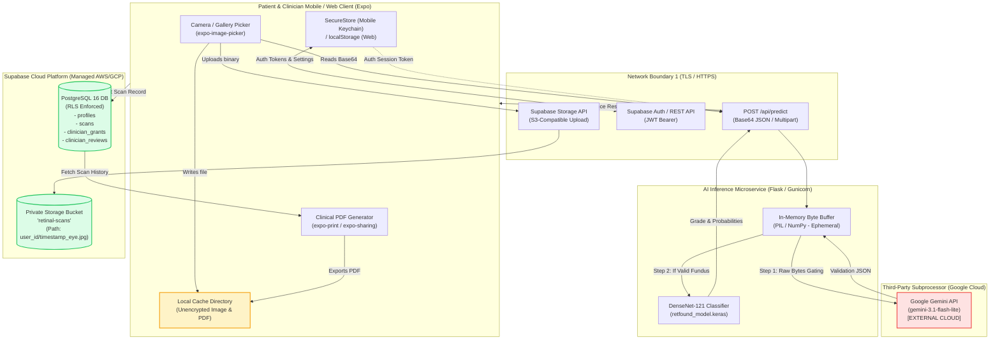

# PRIVACY & DATA PROTECTION AUDIT REPORT
**Application:** Diabetic Retinopathy Diagnostic System (Web, Mobile & AI Backend)  
**Audit Phase:** Phase 1 — Comprehensive Architecture, Medical Data & Compliance Audit  
**Auditor:** Agent 5 — Privacy & Data Protection Auditor  
**Date:** November 2026  
**Status:** Complete  

---

## 1. Executive Summary

This audit assesses the data protection posture, patient privacy guarantees, image storage architecture, and regulatory compliance of the Diabetic Retinopathy Diagnostic System. The evaluated system comprises an Expo/React Native mobile application, a containerized Flask/DenseNet-121 deep learning inference engine, a Google Gemini multimodal pre-screening triage gate, and a Supabase managed cloud backend (PostgreSQL 16 with Row-Level Security and private object storage).

### Key Strengths Identified
1. **Private Cloud Storage Architecture:** The Supabase storage bucket (`retinal-scans`) is configured as strictly private (`public = false`), preventing unauthenticated public URL access to patient retinal photographs.
2. **Robust Database Row-Level Security (RLS):** Granular PostgreSQL RLS policies segregate patient records (`public.scans`, `public.profiles`, `public.follow_up_reminders`) ensuring patients cannot query or tamper with each other's data.
3. **Cryptographic Clinician Access Delegation:** Patient-authorized sharing uses time-bounded (24-hour), single-use delegation codes (`grant_code`) with automated code consumption upon clinician redemption, preventing unconsented practitioner access.
4. **Anti-Tampering Role Protection:** Database triggers (`protect_profile_security`) prevent client-side privilege escalation, ensuring patients and unverified clinicians cannot self-promote or approve clinical credentials.
5. **Ephemeral Backend Inference:** The Flask inference backend (`app.py`) operates as a stateless in-memory processor, avoiding disk caching of uploaded retinal photographs during model execution.

### Critical Vulnerabilities & Compliance Gaps
1. **[CRITICAL] Unconsented Transmission of Biometric PHI to Third-Party Consumer LLM (HIPAA / GDPR Violation):** Retinal fundus photographs (special category biometric health data) are transmitted to the Google Gemini API (`gemini-3.1-flash-lite`) via a standard Google AI Studio developer API key without an executed **Business Associate Agreement (BAA)** under HIPAA (45 CFR § 164.502(e)) or a formal **Data Processing Addendum (DPA)** with Standard Contractual Clauses (SCCs) under GDPR Art. 28. Furthermore, no patient informed consent is collected prior to third-party transmission.
2. **[CRITICAL] Incomplete Data Deletion & Stranded Storage Objects (GDPR Art. 17 Violation):** While database records support deletion, the Supabase storage bucket (`retinal-scans`) **lacks a DELETE RLS policy** on `storage.objects`. Consequently, patients cannot delete their retinal images from cloud storage. Furthermore, the client-side "Delete Everything" action in `profile.tsx` is an unimplemented UI stub that does not trigger data purging.
3. **[HIGH] Unauthenticated Backend Inference & Permissive Wildcard CORS:** The Flask inference endpoint (`/api/predict`) bypasses JWT verification when `SUPABASE_JWT_SECRET` is unset (the default in `.env`), allowing anonymous network callers to process scans without identity attribution. Simultaneously, `app.py` configures `CORS(app, resources={r"/api/*": {"origins": "*"}}, supports_credentials=True)`, creating severe cross-origin security and data leakage risks.
4. **[HIGH] Unencrypted Residual PHI on Mobile Local File Systems:** The mobile app leaves raw fundus images in the device's temporary cache directory after image selection, and stores unencrypted full-record medical summaries (`clinical_retinal_summary_<timestamp>.pdf`) in `FileSystem.cacheDirectory` indefinitely without cleanup.
5. **[MEDIUM] Web Storage Token Insecurity:** On Web platforms, the Supabase client and AuthContext store authentication tokens and user settings in unencrypted browser `localStorage`, exposing user sessions to Cross-Site Scripting (XSS) extraction.

---

## 2. Comprehensive Data-Flow Map

The diagram below traces the end-to-end lifecycle of sensitive medical imagery, clinical notes, and patient PII across all actors, network boundaries, and third-party subprocessors.



---

## 3. Sensitive Medical Data & PII Classification Inventory

| Data Element | Technical Location | Data Classification | Sensitivity | Regulatory Governance |
| :--- | :--- | :--- | :--- | :--- |
| **Patient Full Name** | `profiles.full_name`, JWT metadata, PDF exports | Direct PII | High | HIPAA § 164.514, GDPR Art. 4(1) |
| **Email Address** | `auth.users.email`, `profiles`, login form | Direct PII | High | HIPAA § 164.514, GDPR Art. 4(1) |
| **Contact Phone Number** | `profiles.phone_number` | Direct PII | Medium | HIPAA § 164.514, GDPR Art. 4(1) |
| **Retinal Fundus Image** | Mobile cache, memory, Supabase Storage, Gemini API | **Biometric Health Data (PHI)** | **Critical** | HIPAA § 160.103, GDPR Art. 9(1) & 4(14) |
| **Anatomical Target Eye** | `scans.eye` ('OD', 'OS', 'OU') | Medical / PHI | High | HIPAA § 160.103, GDPR Art. 9 |
| **Retinopathy Grade (0-4)** | `scans.grade`, API response, PDF reports | Diagnostic Medical Data | High | HIPAA § 160.103, GDPR Art. 9 |
| **Prediction Probabilities** | `scans.probabilities` (JSONB) | Diagnostic Medical Data | High | HIPAA § 160.103, GDPR Art. 9 |
| **Patient Clinical Notes** | `scans.patient_notes` | Self-Reported Health Data | High | HIPAA § 160.103, GDPR Art. 9 |
| **Clinician Review & Notes**| `clinician_reviews.review_notes` | Official Clinical PHI | High | HIPAA § 160.103, GDPR Art. 9 |
| **Treatment Recommendation**| `clinician_reviews.clinical_recommendation` | Clinical Care Directive | High | HIPAA § 160.103, GDPR Art. 9 |
| **Doctor License & Degree** | `profiles.medical_license_no`, `medical_degree` | Professional PII | Medium | GDPR Art. 6, State Medical Boards |
| **One-Time Grant Code** | `clinician_access_grants.grant_code` | Authorization Secret | High | HIPAA Access Control Rule |
| **User Settings & Flags** | `user_settings_{id}` (SecureStore / localStorage)| Account Preferences | Low | General Privacy |

---

## 4. Storage Architecture & Access Control Analysis

### 4.1 Supabase Cloud Object Storage (`retinal-scans`)
The storage architecture was evaluated by inspecting `supabase/migrations/001_initial_schema.sql` and client upload calls in `mobile/app/(tabs)/index.tsx`.

* **Bucket Configuration:**  
  ```sql
  INSERT INTO storage.buckets (id, name, public)
  VALUES ('retinal-scans', 'retinal-scans', false)
  ON CONFLICT (id) DO NOTHING;
  ```
  The bucket is explicitly set to `public = false`. Direct HTTP requests to fetch images without an authenticated Supabase token are rejected with HTTP 403 Forbidden.
* **Storage Path Hierarchy:** Images are isolated using a structured prefix:  
  `${user.id}/${timestamp}_${selectedEye}.jpg`
* **Storage Policy Verification:**
  * **Upload (INSERT):** Restricted to authenticated users uploading into their own top-level folder:
    ```sql
    CREATE POLICY "Patients upload own scans to storage"
        ON storage.objects FOR INSERT
        WITH CHECK (bucket_id = 'retinal-scans' AND auth.uid()::text = (storage.foldername(name))[1]);
    ```
  * **Read (SELECT):** Restricted to the owning patient:
    ```sql
    CREATE POLICY "Patients read own scans from storage"
        ON storage.objects FOR SELECT
        USING (bucket_id = 'retinal-scans' AND auth.uid()::text = (storage.foldername(name))[1]);
    ```
  * **Delegated Read (SELECT):** Permitted to clinicians possessing an active, unexpired grant:
    ```sql
    CREATE POLICY "Authorized clinicians read patient scans from storage"
        ON storage.objects FOR SELECT
        USING (bucket_id = 'retinal-scans' AND EXISTS (
            SELECT 1 FROM public.clinician_access_grants g
            WHERE g.patient_id::text = (storage.foldername(name))[1]
              AND g.clinician_id = auth.uid()
              AND g.status = 'active'
              AND g.expires_at > NOW()
        ));
    ```

#### Critical Storage Defect: Missing Deletion & Update Policies
1. **No DELETE Policy:** There is no policy granting `DELETE` operations on `storage.objects` for bucket `retinal-scans`. Even though patients can delete metadata rows in `public.scans`, the Supabase Storage API will reject any client-side `supabase.storage.from('retinal-scans').remove([path])` call.
2. **Orphaned Storage Objects:** If a user account or scan row is deleted in PostgreSQL, the binary retinal image file remains permanently stranded in object storage.
3. **No UPDATE Policy:** Users cannot overwrite or sanitize image metadata directly.

### 4.2 Mobile Device Local Storage
* **Expo SecureStore:**
  * Used on iOS and Android for session token caching and `user_settings_{userId}`.
  * Employs iOS Keychain Services and Android Keystore/EncryptedSharedPreferences.
  * Meets mobile cryptographic standards.
* **Web LocalStorage Fallback Risk:**
  * In `mobile/lib/supabase.ts` (lines 5–33), `ExpoSecureStoreAdapter` falls back to `window.localStorage` when running in a browser:
    ```typescript
    if (Platform.OS === 'web') {
      if (typeof localStorage !== 'undefined') return localStorage.getItem(key);
    }
    ```
  * Storage of JWT access tokens in `localStorage` violates OWASP session management guidelines for healthcare apps due to vulnerability to DOM-based XSS attacks.
* **Residual Cache Files:**
  * `expo-image-picker` writes unencrypted JPEG files to the application sandbox cache.
  * `history.tsx` creates unencrypted PDF summaries (`clinical_retinal_summary_<timestamp>.pdf`) in `FileSystem.cacheDirectory` prior to triggering native sharing.
  * Neither file is expunged after completion, leaving permanent PHI artifacts in the local cache.

### 4.3 Backend Inference Server Memory Management
* `app.py` processes uploads directly from `request.files` or JSON base64 payloads into in-memory `io.BytesIO` streams.
* Images are resized to `(224, 224)` via PIL and cast to `float32` tensors for inference.
* No disk files or temporary scratch buffers are written to the host filesystem.
* Garbage collection frees the memory buffer once the HTTP request completes.

---

## 5. Third-Party Subprocessor & AI Flow Assessment (Google Gemini)

The application incorporates a pre-screening triage gate in `gemini_validator.py` that evaluates retinal images before invoking the DenseNet-121 model.

```
[Patient Fundus Photo] ──> [Flask Server] ──> [Google Gemini API] ──> [Classification]
                                                    │
                                           (gemini-3.1-flash-lite)
```

### Privacy & Legal Compliance Deficiencies
1. **Transmission of Protected Health Information (PHI) Without a BAA:**
   * Fundus photographs depict retinal vascular architecture, which constitutes biometric identifier data and diagnostic PHI.
   * Transmitting PHI to Google’s API using an API key generated from Google AI Studio violates **HIPAA 45 CFR § 164.502(e)**. Google AI Studio terms of service explicitly disclaim HIPAA compliance and permit Google to use submitted content for model training and human review unless provisioned through Google Cloud Vertex AI under a signed HIPAA Business Associate Agreement.
2. **Cross-Border Transfer Without Safeguards (GDPR Art. 44–49):**
   * If operated in the European Union or United Kingdom, sending patient fundus images to Google’s public API endpoints without verified EU data residency or standard contractual clauses (SCCs) constitutes an unlawful cross-border transfer of Special Category Personal Data.
3. **Absence of Informed Consent:**
   * Neither `register.tsx` nor `index.tsx` informs patients that their medical images will be transmitted to an external multimodal AI service operated by Google.
   * This violates GDPR Article 6 (Lawful basis) and Article 9(2)(a) (Explicit consent for health data).
4. **Hardcoded API Key Presence in Local Environment:**
   * A live Google Gemini API key was identified in `.env` (`GEMINI_API_KEY=AQ.Ab8RN6...`). While excluded from git via `.gitignore`, the key exists in plaintext on development machines.

---

## 6. Access Control & Clinical Delegation Audit

### 6.1 Row-Level Security (RLS) Policy Audit Table

| Database Table | Policy Name | Command | Target / Predicate | Security Assessment |
| :--- | :--- | :--- | :--- | :--- |
| `public.profiles` | Users view own profile | SELECT | `auth.uid() = id` | **PASS** — Enforces user isolation |
| `public.profiles` | Users update own profile | UPDATE | `auth.uid() = id` | **PASS** — Enforces ownership |
| `public.profiles` | Patients view verified clinicians | SELECT | `role = 'clinician' AND is_verified = TRUE` | **PASS** — Restricts clinician directory |
| `public.profiles` | Users insert own profile | INSERT | `auth.uid() = id` | **PASS** — Allows registration onboarding |
| `public.scans` | Patients view own scans | SELECT | `auth.uid() = patient_id` | **PASS** — Prevents cross-patient viewing |
| `public.scans` | Patients insert own scans | INSERT | `auth.uid() = patient_id` | **PASS** — Enforces scan ownership |
| `public.scans` | Patients update own scans | UPDATE | `auth.uid() = patient_id` | **PASS** — Enforces scan ownership |
| `public.scans` | Patients delete own scans | DELETE | `auth.uid() = patient_id` | **PASS** — Allows patient row deletion |
| `public.scans` | Authorized clinicians view scans | SELECT | `EXISTS (clinician_access_grants active & unexpired)` | **PASS** — Strictly time-bounded delegation |
| `clinician_access_grants` | Patients manage their grants | ALL | `auth.uid() = patient_id` | **PASS** — Full patient sovereign control |
| `clinician_access_grants` | Clinicians view assigned grants | SELECT | `auth.uid() = clinician_id` | **PASS** — Scoped to assigned practitioner |
| `clinician_access_grants` | Clinicians claim grant with code | UPDATE | `clinician_id IS NULL AND status = 'active'` | **PASS** — Atomic code redemption |
| `clinician_reviews` | Patients view reviews on scans | SELECT | `EXISTS (scans.patient_id = auth.uid())` | **PASS** — Read access to second opinions |
| `clinician_reviews` | Clinicians create reviews | INSERT | `is_verified = TRUE AND active grant exists` | **PASS** — Verified doctor gating |
| `follow_up_reminders` | Patients manage own reminders | ALL | `auth.uid() = patient_id` | **PASS** — Isolated reminder management |
| `storage.objects` | Patients upload own scans | INSERT | `auth.uid() = (foldername)[1]` | **PASS** — User folder isolation |
| `storage.objects` | Patients read own scans | SELECT | `auth.uid() = (foldername)[1]` | **PASS** — User folder isolation |
| `storage.objects` | Authorized clinicians read scans | SELECT | `EXISTS (active & unexpired grant)` | **PASS** — Delegated image retrieval |
| `storage.objects` | **Patients delete own scans** | **DELETE** | **NONE** | **FAIL — Missing DELETE policy** |

### 6.2 Horizontal & Vertical Privilege Escalation Protection
* **Privilege Escalation via Profile Modification:** Defended by `protect_profile_security()` in migration `003_doctor_registration_and_roles.sql`. If a standard authenticated user submits `role = 'clinician'` or `is_verified = TRUE`, the BEFORE trigger forces `NEW.role = OLD.role` and `NEW.is_verified = OLD.is_verified`.
* **Grant Code Hijacking / Replay:** The stored procedure `redeem_clinician_grant(p_grant_code)` updates `clinician_id = auth.uid()` and atomically nullifies `grant_code = NULL`, preventing code re-use or concurrent race conditions.

---

## 7. Transport Security & Network Boundaries

### 7.1 Backend API Authentication (`app.py`)
In `app.py` (lines 178–199), authentication is conditionally executed:
```python
def verify_auth_token():
    secret = os.environ.get("SUPABASE_JWT_SECRET")
    if not secret:
        # Development mode: auth check bypassed if no secret configured
        return True, None
```
* **Vulnerability:** When deployed without `SUPABASE_JWT_SECRET`, any anonymous client on the network can POST medical images to `/api/predict`.
* **Remediation Requirement:** In production, the API must fail closed if `SUPABASE_JWT_SECRET` is missing (`raise RuntimeError("SUPABASE_JWT_SECRET must be configured in production")`).

### 7.2 Permissive CORS Policy
In `app.py` (line 206):
```python
CORS(app, resources={r"/api/*": {"origins": "*"}}, supports_credentials=True)
```
* **Vulnerability:** `origins: "*"` with `supports_credentials=True` exposes the endpoint to cross-origin abuse. Although modern browsers reject credentials on wildcard origins, malicious actors on local networks or WebView environments can exploit loose origin filtering.
* **Remediation Requirement:** Whitelist specific application origins (e.g., `capacitor://localhost`, `https://yourdomain.com`).

---

## 8. Data Retention, Portability & Deletion ("Right to Erasure")

### 8.1 Right to Erasure (GDPR Art. 17) Gap Analysis
In `mobile/app/(tabs)/profile.tsx` (lines 114–131), the "Permanently Delete Account & Images" function is structured as follows:
```typescript
const handleDeleteAccount = () => {
  Alert.alert(
    'Delete Medical Account?',
    'Warning: This action is permanent...',
    [
      { text: 'Cancel', style: 'cancel' },
      {
        text: 'Delete Everything',
        style: 'destructive',
        onPress: async () => {
          Alert.alert(
            'Account Deletion Requested',
            'Please contact system support or your medical provider to complete identity-verified permanent deletion.'
          );
        },
      },
    ]
  );
};
```
* **Findings:**
  1. The deletion feature is purely simulated and does not execute any API call, RPC, or database transaction.
  2. Supabase does not permit standard client users to delete their own account from `auth.users` without a secure RPC or Edge Function executing with `service_role` privileges.
  3. No cascading trigger exists to purge files in `storage.objects` when a user or scan row is deleted.

### 8.2 Right to Data Portability (GDPR Art. 20)
* **Strengths:** The mobile app provides a comprehensive longitudinal PDF report generator in `history.tsx` using `expo-print`, compiling examination dates, eye designations, severity grades, probability distributions, and clinical notes.
* **Gaps:** The "Download Complete Health Record" button in `profile.tsx` (line 106) is an alert stub. The system lacks a machine-readable export format (JSON or FHIR standard) required by GDPR Art. 20.

---

## 9. Regulatory Compliance Scorecard

### 9.1 HIPAA Security & Privacy Rules (45 CFR Parts 160 & 164)

| HIPAA Specification | Section | Status | Audit Evaluation |
| :--- | :--- | :--- | :--- |
| **Unique User Identification** | § 164.312(a)(2)(i) | **PASS** | Supabase Auth assigns unique UUIDs to each patient and doctor. |
| **Emergency Access Procedure** | § 164.312(a)(2)(ii) | **FAIL** | No break-glass protocol for emergency clinician review. |
| **Automatic Logoff** | § 164.312(a)(2)(iii) | **PARTIAL** | Tokens refresh automatically; no idle session timeout on mobile. |
| **Encryption at Rest** | § 164.312(a)(2)(iv) | **PASS** | Supabase database and storage are encrypted at the volume layer (AES-256). |
| **Audit Controls** | § 164.312(b) | **FAIL** | No immutable logging of who viewed or exported patient retinal scans. |
| **Transmission Security** | § 164.312(e)(1) | **PARTIAL** | HTTPS enforced in cloud, but development setup permits plaintext HTTP. |
| **Business Associate Contracts** | § 164.502(e) | **FAIL** | **No HIPAA BAA executed with Google for Gemini validation triage.** |
| **Minimum Necessary Disclosure** | § 164.502(b) | **PASS** | Clinician access delegation restricts visibility to authorized patients only. |

### 9.2 GDPR Assessment (Regulation EU 2016/679)

| GDPR Article | Requirement | Status | Audit Evaluation |
| :--- | :--- | :--- | :--- |
| **Article 5(1)(c)** | Data Minimization | **PASS** | Only retinal images and essential medical credentials are collected. |
| **Article 6 & 9(2)(a)** | Explicit Consent for Health Data | **FAIL** | No explicit consent collected for cloud storage or third-party AI analysis. |
| **Article 13 & 14** | Privacy Notice & Transparency | **FAIL** | No in-app Privacy Policy or disclosure of subprocessors (Google, Supabase). |
| **Article 17** | Right to Erasure ("To be Forgotten") | **FAIL** | UI deletion is a stub; storage bucket lacks DELETE RLS policy. |
| **Article 20** | Right to Data Portability | **PARTIAL** | PDF export is operational; machine-readable JSON export is absent. |
| **Article 28** | Data Processor Governance | **FAIL** | No formal Data Processing Addendum (DPA) covering Google Gemini. |
| **Article 32** | Security of Processing | **PASS** | Strong RLS policies, non-root Docker container, and secure credential storage. |
| **Article 35** | Data Protection Impact Assessment | **FAIL** | No formal DPIA conducted for automated diagnostic AI triage. |

---

## 10. Prioritized Recommendations & Remediation Roadmap

### Priority 0: Critical Blockers (Remediate Before Production Launch)

1. **Execute HIPAA BAA & Migrate Gemini to Vertex AI:**
   * Transition `gemini_validator.py` from consumer Google AI Studio API keys to enterprise **Google Cloud Vertex AI**.
   * Execute a formal Google Cloud Business Associate Agreement (BAA) and GDPR Data Processing Addendum (DPA).
   * Configure Vertex AI data governance to guarantee zero human review and zero retention for model training.

2. **Add Storage DELETE RLS Policy & Implement Real Account Erasure:**
   * Add a DELETE policy to `storage.objects` in Supabase:
     ```sql
     CREATE POLICY "Patients delete own scans from storage"
         ON storage.objects FOR DELETE
         USING (bucket_id = 'retinal-scans' AND auth.uid()::text = (storage.foldername(name))[1]);
     ```
   * Create an administrative PostgreSQL RPC (`delete_user_account()`) or Supabase Edge Function that deletes the user's `storage.objects`, purges database rows, and deletes `auth.users`. Connect this function to `handleDeleteAccount` in `profile.tsx`.

3. **Enforce Mandatory JWT Authentication on Backend API:**
   * Update `app.py` to enforce authentication in all non-testing environments:
     ```python
     if not secret and not app.config.get("TESTING"):
         raise RuntimeError("SUPABASE_JWT_SECRET must be configured. Bypassing auth is prohibited.")
     ```
   * Restrict CORS origins in `app.py` to verified application domains.

### Priority 1: High Priority (Remediate in Next Release Sprint)

4. **Implement Patient Informed Consent Screen:**
   * Add an interactive consent modal during registration and prior to first scan submission.
   * Require explicit checkboxes acknowledging: (a) automated AI pre-screening screening aid notice, (b) secure cloud storage in Supabase, and (c) processing by medical AI models.

5. **Sanitize Mobile Local Cache:**
   * In `mobile/app/(tabs)/index.tsx`, invoke `FileSystem.deleteAsync(imageUri, { idempotent: true })` immediately after base64 conversion or upload completion.
   * In `mobile/app/(tabs)/history.tsx`, implement a cleanup hook to purge generated PDF summaries from `FileSystem.cacheDirectory` after sharing dialog dismissal.

6. **Resolve Web Storage Security:**
   * On Web platforms, replace `localStorage` token storage with secure, `httpOnly`, `SameSite=Strict` cookies to neutralize token theft via XSS.

### Priority 2: Medium / Strategic Enhancements

7. **Implement Access Audit Logging:**
   * Create an immutable audit table `public.scan_access_logs (id, scan_id, accessed_by, access_type, created_at)`.
   * Automatically record an entry whenever a clinician views or downloads a patient's retinal scan.

8. **Implement Standardized FHIR / JSON Medical Export:**
   * Add a machine-readable JSON export function in `profile.tsx` conforming to HL7 FHIR DiagnosticReport standards for seamless interoperability with Electronic Health Records (EHR).

9. **Automated Data Retention & Lifecycle Policies:**
   * Configure a pg_cron scheduled job to archive or soft-delete scans exceeding the medical record retention period (e.g., 7 years) and automatically prune expired clinician access grants.

---
*Report certified by Agent 5: Privacy & Data Protection Auditor.*
