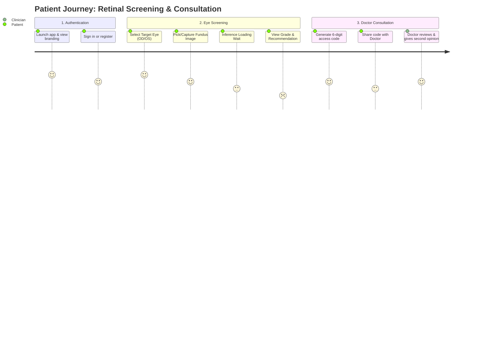
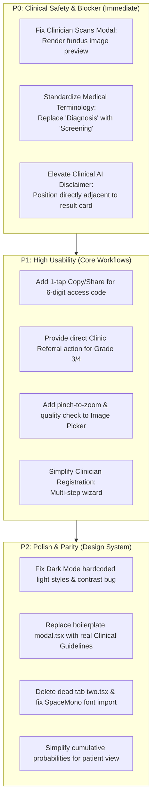

# UI/UX Audit Report: Diabetic Retinopathy Screening System

**File:** `audit/07_ui_ux_audit.md`  
**Date:** November 22, 2026  
**Auditor:** Agent 6 (UI/UX Auditor)  
**Target Applications:** 
- Mobile Client (`mobile/app/` - Expo / React Native 0.88 / Expo Router v58)
- Embedded Web Screening Portal (`app.py` - Flask HTML UI)
- Exported Clinical Reporting System (`mobile/app/(tabs)/history.tsx` - PDF Generator)

---

## 1. Executive Summary

This comprehensive UI/UX evaluation assesses the Diabetic Retinopathy Screening System across its mobile application and web interfaces from the distinct perspectives of **real patients** and **practicing clinicians**. 

The application demonstrates strong foundational design choices: an intentional clinical color palette (Clinical Teal `#007A87` and Midnight Slate Navy `#0F1E36`), modern typography with *Plus Jakarta Sans*, role segregation (Patient vs. Clinician), dual-eye classification (`OD` Right Eye vs. `OS` Left Eye), and a secure one-time delegation workflow for clinical reviews.

However, the audit identified **critical clinical communication hazards**, **severe workflow gaps for healthcare providers**, **dark mode contrast regressions**, and **several orphaned/boilerplate screens**. Most significantly:
1. **Clinical Communication & Diagnostic Framing Hazard**: Multiple screens and buttons frame the AI output as a definitive *"Diagnosis"* or *"Diagnostic Assessment"* rather than an automated screening aid, violating medical device software (SaMD/FDA/EU MDR) guidelines.
2. **Clinician Scans Inspection Blindspot**: When a doctor opens a patient's authorized scans in the Clinician Portal (`mobile/app/(tabs)/clinicians.tsx`), the modal displays numerical grades and textual descriptions but **completely omits the fundus photograph itself**. Clinicians cannot perform a second opinion without visualizing the retina.
3. **High-Severity Anxiety Spike without Immediate Action**: When Grade 3 (Severe) or Grade 4 (Proliferative DR) is detected, the patient is presented with an alarming red warning, while the mandatory clinical disclaimer is hidden off-screen at the bottom of the scroll view, and there is no 1-tap emergency ophthalmic referral action.
4. **Cognitive Load in Probabilities Presentation**: Patients are exposed to raw "Cumulative Threshold Scores" (e.g., Grade ≥ 0: 99.8%, Grade ≥ 1: 94.2%...) derived from ordinal logistic regression without explanatory tooltips or layman risk framing.
5. **Orphaned Boilerplate Screens**: `mobile/app/modal.tsx` (configured in `_layout.tsx` as "Clinical Screening Guidelines") and `mobile/app/(tabs)/two.tsx` contain default unedited Expo boilerplate (`EditScreenInfo`).

### Persona-Based Evaluation Scorecard

| Dimension | Patient Score (1–10) | Clinician Score (1–10) | Severity / Status | Key Concern |
| :--- | :---: | :---: | :---: | :--- |
| **Visual Hierarchy & Aesthetics** | 8.5 / 10 | 8.0 / 10 | 🟢 Good | Clean cards, consistent borders, polished typography |
| **Color & Theme Consistency** | 7.0 / 10 | 7.0 / 10 | 🟡 Moderate | Hardcoded light containers in dark mode; poor badge contrast |
| **Medical / Clinical Safety Framing**| 4.5 / 10 | 6.0 / 10 | 🔴 Critical | Overclaiming "Diagnosis" rather than "Screening Aid" |
| **Image Upload & Capture UX** | 6.5 / 10 | 5.5 / 10 | 🟡 Moderate | 1:1 aspect ratio crops fundus cameras; no zoom inspection |
| **Diagnostic Results Presentation** | 6.0 / 10 | 6.5 / 10 | 🟡 Moderate | Cumulative logits confuse patients; no lesion localization |
| **Clinician Workflow Usability** | N/A | 3.5 / 10 | 🔴 Critical | Inspection modal lacks retinal image display |
| **Longitudinal Tracking & Export** | 8.0 / 10 | 7.5 / 10 | 🟢 Good | Filter by eye, PDF export works, but PDF lacks fundus images |
| **Error Handling & Empty States** | 7.5 / 10 | 7.0 / 10 | 🟢 Good | Descriptive empty cards, but relies heavily on native alerts |

---

## 2. Persona & User Journey Mapping



### Persona 1: The Diabetic Patient ("Arthur", Age 58, Type 2 Diabetic)
* **Context**: Arthur was diagnosed with Type 2 diabetes 8 years ago. His GP advised him that diabetic retinopathy can cause irreversible blindness if untreated. He is anxious about vision loss and has moderate smartphone literacy.
* **Goals**: Quickly scan fundus images from his optometrist, understand if his eyes are healthy, track whether his condition is worsening, and easily send results to his ophthalmologist.
* **Journey Pain Points**:
  - **Emotional Shock**: Arthur receives a "Grade 3: Severe NPDR" result. The red card and clinical terminology induce panic. The disclaimer stating "not a diagnosis" is hidden off-screen below the fold.
  - **Cognitive Confusion**: Seeing five separate progress bars with percentages like "Grade ≥ 0: 99.9%, Grade ≥ 1: 91.2%, Grade ≥ 2: 74.0%" leads him to believe he has multiple conflicting conditions simultaneously.
  - **Sharing Friction**: To share his scans with Dr. Chen, Arthur generates a 6-digit code (`mobile/app/(tabs)/clinicians.tsx`), but the screen has **no "Copy" or "Share via WhatsApp/SMS" button**. He has to memorize or write the number down on paper.

### Persona 2: The Attending Ophthalmologist ("Dr. Chen", MD, Retinal Specialist)
* **Context**: Dr. Chen sees 30+ patients a day in a busy outpatient clinic. She needs fast, frictionless access to patient images, clear AI decision-support aids, and the ability to rapidly record a second opinion.
* **Goals**: Input patient delegation code, view high-resolution fundus images (macula, optic disc, vasculature), verify AI grading against clinical ICDRS criteria, and record verified second opinions.
* **Journey Pain Points**:
  - **Critical Failure**: When Dr. Chen taps "View Scans" (`mobile/app/(tabs)/clinicians.tsx` line 730), she sees a text list showing: *"DenseNet-121 Diagnosis: Grade 2 (Moderate NPDR)"*, but **no image is rendered**. A retina specialist cannot validate an automated prediction without viewing the fundus photograph!
  - **Registration Fatigue**: Onboarding as a clinician requires completing 10+ manual text inputs (`mobile/app/(auth)/register.tsx`) on a single mobile screen without auto-completion for medical license registries.

---

## 3. Screen-by-Screen UI/UX Audit

### 3.1 Authentication & Onboarding (`login.tsx`, `register.tsx`)

#### Findings & Observations:
1. **Keyboard Ergonomics**: Both screens utilize `KeyboardAvoidingView` (with iOS padding), `ScrollViewInstance` refs, and `returnKeyType="next"` / `returnKeyType="done"`. Auto-scroll on validation failure ensures the user sees error banners without getting trapped behind the virtual keyboard.
2. **Visual Hierarchy**: Consistent header badge (`CLINICAL AI PORTAL`), well-spaced input fields with icon indicators (`Mail`, `Lock`, `User`, `BriefcaseMedical`).
3. **Clinician Registration Overload (`mobile/app/(auth)/register.tsx#L147-L177`)**:
   - Switching the role toggle to *"Clinician / Eye Specialist"* dynamically exposes 8 additional professional fields (Degree, Medical License, Jurisdiction Authority, Specialty, Years of Experience, Institution Name, Clinic City, Phone Number).
   - This creates an intimidating, lengthy single-page form with 12 total text inputs. 
   - There are no dropdowns/pickers for Jurisdiction (e.g. state medical boards or GMC) or Medical Qualifications, forcing free-text typing.
4. **Verification Status Expectations**: When a clinician registers, the app creates their account with `is_verified: false` and `verification_status: 'pending'`. The post-registration alert clearly explains this, setting appropriate expectations before entering the workspace.

### 3.2 Screening & Inference Workspace (`mobile/app/(tabs)/index.tsx`)

#### Findings & Observations:
1. **Target Eye Selection (`index.tsx#L278-L309`)**:
   - Clear toggle buttons for **Right Eye (OD)** and **Left Eye (OS)**.
   - Distinct selected state using primary teal background (`#007A87`).
2. **Image Picker & Framing (`index.tsx#L41-L71`)**:
   - Camera and Gallery options with permission handling and native permission alerts.
   - **Aspect Ratio Locking**: `aspect: [1, 1]` forces a square crop. While fundus photographs are circular or centered, modern portable fundus cameras and indirect ophthalmoscope adapters output rectangular 4:3 or 16:9 images. Forcing a 1:1 crop risks cutting off peripheral hemorrhages or the temporal macula.
   - **Missing Image Inspection / Zoom**: In `index.tsx#L539-L543`, the selected image is displayed in a fixed `height: 240` preview. Users cannot pinch-to-zoom or inspect sharpness to verify that the optic disc and fovea are in focus before submitting.
3. **Inference Trigger & Loading State (`index.tsx#L368-L379`)**:
   - Button text: `"Run AI Diagnostic Assessment"` (Clinical safety concern; see Section 5).
   - When loading, the button disables, changes opacity, and displays an `ActivityIndicator`.
   - **Gaps**: No progress percentage for multipart upload over slow cellular connections. No cancel button if inference hangs.
4. **Results Presentation (`index.tsx#L384-L442`)**:
   - **Severity Badges**:
     - Grade 0: Green badge (`#ECFDF5`, border `#A7F3D0`, text `#047857`) with `CheckCircle`.
     - Grade 1–4: Warning/Critical badges with `AlertTriangle` and progressive orange/red hues.
   - **Clinical Recommendation Card**: Tailored guidance (e.g. Grade 0 recommends routine check in 12 months; Grade 4 advises urgent photocoagulation/anti-VEGF evaluation).
   - **Probability Breakdown Display**:
     - Displays `Grade ≥ 0` through `Grade ≥ 4` horizontal bar graphs with percentage readouts (`index.tsx#L423-L439`).
     - Visually polished, but highly confusing for lay patients who expect a single confidence score.
5. **Persistence & Silent Failures (`index.tsx#L185-L227`)**:
   - After inference completes, the app persists the scan and image to Supabase.
   - If storage upload or database insertion fails, it outputs `console.warn` silently. The user is not informed whether their record was stored in their permanent history.

### 3.3 Scan History & Longitudinal Tracking (`mobile/app/(tabs)/history.tsx`)

#### Findings & Observations:
1. **Longitudinal Eye Filtering (`history.tsx#L361-L381`)**:
   - Segmented filter tabs: `All Eyes (N)`, `Right Eye (OD)`, `Left Eye (OS)`.
   - Responsive pill buttons that update list filtering in real time.
2. **Card Visual Structure (`history.tsx#L424-L466`)**:
   - Each card displays scan date, target eye badge, severity pill, and clinical notes.
   - Clean spacing with card borders and subtle elevation.
   - **Contrast Bug (`history.tsx#L433-L437`)**:
     ```tsx
     <View style={[styles.eyeBadge, { backgroundColor: theme.text, borderColor: theme.border }]}>
       <Eye size={12} color={theme.primary} />
       <Text style={[styles.eyeBadgeText, { color: theme.primary }]}>
         {scan.eye === 'OD' ? 'Right Eye (OD)' : 'Left Eye (OS)'}
       </Text>
     </View>
     ```
     In light mode, `theme.text` is `#0B1A2C` (very dark navy) and `theme.primary` is `#007A87` (teal). This dark-on-dark pairing produces a contrast ratio of **2.84:1**, violating WCAG AA minimum requirements (4.5:1).
3. **Detail View Friction (`history.tsx#L320-L325`)**:
   - Tapping *"View Diagnostic Details"* opens a plain native `Alert.alert` with raw text strings (`"Diagnostic Grade: Grade 2\nClassification: ..."`).
   - It does not open a dedicated scan detail view, does not show the stored retinal image, and does not display the probability breakdown or doctor's second opinion.
4. **Clinical PDF Export (`history.tsx#L113-L318`)**:
   - High-quality clinical report template styled in HTML/CSS.
   - Includes patient metadata card, screening history table, ICDRS reference scale, and formal clinician signature/seal block.
   - Cross-platform support: Uses browser `window.print` on web and native file sharing (`expo-sharing` with cache directory fallback) on iOS/Android.
   - **Missing Element**: The PDF report has no retinal photograph thumbnails.

### 3.4 Clinician Access & Doctor Workspace (`mobile/app/(tabs)/clinicians.tsx`)

#### Findings & Observations:
1. **Dynamic Tab Identity (`TabLayout#L63`)**:
   - The screen dynamically renames itself based on the user's role: *"Patient Consultations"* for doctors, *"Clinician Access"* for patients.
2. **Patient View: Access Delegation (`clinicians.tsx#L578-L606`)**:
   - Generates a cryptographically randomized 6-digit access code (e.g. `482-910`) valid for 24 hours.
   - Displays authorized doctors with license numbers, granted timestamps, and an explicit **Revoke** action (`Trash2`).
   - **UX Defect**: No "Copy to Clipboard" button or native Share Sheet integration. Patients must manually copy or transcribe the code.
3. **Doctor View: Code Redemption (`clinicians.tsx#L492-L527`)**:
   - Clean input field with letter spacing and uppercase formatting.
   - One-tap "Claim Access" button with spinner.
4. **Doctor View: Patient Scans Inspection Modal (`clinicians.tsx#L729-L820`)**:
   - **CRITICAL DEFECT**: The modal fetches and lists scans from Supabase (`clinicians.tsx#L261`), but lines 760–815 only render:
     - Target eye badge (`OD` vs `OS`)
     - Date
     - Grade text: `"DenseNet-121 Diagnosis: Grade 2 (Moderate non-proliferative...)"`
     - Existing doctor review notes
     - *"Record Clinical Second Opinion"* button
   - **There is NO `<Image>` component in this modal!** The doctor is asked to provide a second opinion on a retinal scan without being able to look at the retinal image!
5. **Doctor View: Second Opinion Submission Modal (`clinicians.tsx#L825-L925`)**:
   - Allows selecting a confirmed clinical grade (0 to 4) using radio-style list buttons.
   - Multiline text area for clinical evaluation notes.
   - Multiline text area for patient recommendation.
   - Enforces verification gating: if `!profile?.is_verified`, the button is locked with message *"Review Locked (Unverified)"*.

### 3.5 Settings & Profile Workspace (`mobile/app/(tabs)/profile.tsx`)

#### Findings & Observations:
1. **Header Identity Card**:
   - Distinct avatar styling: Patient (`User` icon on teal `#007A87`) vs. Clinician (`BriefcaseMedical` on blue `#0284C7`).
   - Dynamic verification badges: `"Verified Clinician"` (green pill) vs. `"Pending Verification"` (amber pill).
2. **Doctor-Specific Credentials Card (`profile.tsx#L183-L277`)**:
   - Clearly documents Degree, Medical License, Jurisdiction, Practice Location, Specialty, and Experience.
   - Includes an educational banner explaining that unverified clinicians can inspect in read-only mode but cannot sign clinical reviews.
3. **Security Toggles**:
   - Biometric Screen Lock switch (FaceID/TouchID).
   - Offline Encrypted Cache switch (`SecureStore`).
4. **Destructive Actions Guardrails (`profile.tsx#L113-L130`)**:
   - "Permanently Delete Account & Images" has a two-step confirmation alert with `destructive` action styling.

### 3.6 Modal & Orphaned Boilerplate Screens

#### Findings & Observations:
1. **`mobile/app/modal.tsx`**:
   - Configured in `mobile/app/_layout.tsx#L135-L142` as:
     ```tsx
     <Stack.Screen
       name="modal"
       options={{
         presentation: 'modal',
         title: 'Clinical Screening Guidelines',
         headerTintColor: activeColors.primary,
       }}
     />
     ```
   - However, `mobile/app/modal.tsx` contains pure Expo starter code:
     ```tsx
     <Text style={styles.title}>Modal</Text>
     <EditScreenInfo path="app/modal.tsx" />
     ```
   - Furthermore, there is **no button or link anywhere in the tabs** that navigates to this modal. It is completely disconnected.
2. **`mobile/app/(tabs)/two.tsx`**:
   - Contains placeholder `TabTwoScreen` with `EditScreenInfo`.
   - Hidden from the tab bar via `href: null` in `TabLayout`, but remaining in the codebase as dead code.
3. **`mobile/app/+not-found.tsx`**:
   - Minimalist 404 page with "This screen doesn't exist" and link back to home. Clean and functional.

### 3.7 Web Interface (Flask Embedded Web Portal in `app.py`)

#### Findings & Observations:
1. **Architecture & Scope (`app.py#L63-L141`)**:
   - Served via Flask route `GET /` and `POST /predict`.
   - Clean, lightweight vanilla CSS matching the mobile color system (`--primary: #007A87; --navy: #0F1E36; --accent: #00B4D8; --bg: #F4F8FA`).
2. **Strengths**:
   - Explicit disclaimer notice in yellow box: *"Clinical Screening Notice: Research prototype only. This prediction is an automated screening aid and not a medical diagnosis..."*.
   - Submit button automatically updates to `"Analyzing Retinal Image…"` and disables to prevent duplicate submissions.
3. **UX Deficiencies**:
   - **No Image Preview**: The file input (`<input type="file">`) does not display a thumbnail preview of the chosen image before the user clicks Submit.
   - **No Eye Selection**: Does not prompt whether the image is Right Eye (OD) or Left Eye (OS).
   - **No Probability Breakdown**: The results section only displays `Grade X: <Label>`, omitting the cumulative probability distribution.
   - **Disconnected from Database**: Does not save scans to Supabase, has no authentication, and cannot integrate with patient longitudinal records.

---

## 4. Visual Consistency, Typography, & Color Hierarchy

### 4.1 Design System & Palette Audit

```
Primary Clinical Teal:   #007A87  (Brand, Primary Action, Selected Tabs)
Primary Hover:           #006670  (Hover States, Web Interactive)
Midnight Slate Navy:     #0F1E36  (Dark Card Headers, Clinical Depth)
Accent Bright Cyan:      #00B4D8  (Highlights, Active Cues)
Surface White:           #FFFFFF  (Cards, Modals)
Canvas Background:       #F4F8FA  (Calm, Clinical Light Tint)
Text Primary:            #0B1A2C  (High-legibility Dark Slate)
Text Muted:              #5A6E85  (Subtitles, Captions, Secondary Labels)
```

#### Diabetic Retinopathy Severity Tokens (`SeverityColors` in `Colors.ts`):
- **Grade 0 (No DR)**: Mint Green (`#ECFDF5` / `#10B981` / `#047857`)
- **Grade 1 (Mild NPDR)**: Teal Aqua (`#F0FDFA` / `#14B8A6` / `#0F766E`)
- **Grade 2 (Moderate NPDR)**: Amber Gold (`#FFFBEB` / `#F59E0B` / `#B45309`)
- **Grade 3 (Severe NPDR)**: Burnt Orange (`#FFF7ED` / `#EA580C` / `#C2410C`)
- **Grade 4 (Proliferative DR)**: Alert Crimson (`#FEF2F2` / `#DC2626` / `#B91C1C`)

### 4.2 Dark Mode Deficiencies & Inconsistencies

While `Colors.ts` defines comprehensive `light` and `dark` palettes, multiple components hardcode light-mode hex codes directly into stylesheet objects:

| File | Code Location | Hardcoded Value | Dark Mode Impact |
| :--- | :--- | :--- | :--- |
| `index.tsx` | Line 633 (`adviceBox`) | `backgroundColor: '#F8FAFC'`, `color: '#334155'` | Blinding light grey box in dark mode; poor text contrast |
| `index.tsx` | Line 692 (`disclaimerBox`) | `backgroundColor: '#FFFBEB'`, `color: '#92400E'` | Bright amber box clashes with dark navy theme |
| `index.tsx` | Line 495 (`toggleGroup`) | `backgroundColor: '#E2E8F0'` | High-contrast grey pill in dark theme |
| `history.tsx` | Line 522 (`filterTab`) | `backgroundColor: '#E2E8F0'`, `color: '#475569'` | Inactive tabs appear washed out in dark mode |
| `history.tsx` | Line 433 (`eyeBadge`) | `backgroundColor: theme.text` (`#0B1A2C` / `#F1F5F9`) | Contrast inversion bug; teal text on dark background in light mode |
| `clinicians.tsx`| Line 852 (`gradeOptionBtn`)| `backgroundColor: '#E0F2FE'` | Harsh light-blue button highlight in dark modal |

### 4.3 Typography & Font Loading Audit

- **Primary Font**: *Plus Jakarta Sans* (`400Regular`, `500Medium`, `600SemiBold`, `700Bold`) is loaded in `RootLayout` via `@expo-google-fonts/plus-jakarta-sans`.
- **Font Loading Defect**: In `mobile/components/StyledText.tsx`, `MonoText` references `fontFamily: 'SpaceMono'`. However, `SpaceMono` is **not included in `useFonts` in `_layout.tsx`**! If any component renders `MonoText` (such as `EditScreenInfo`), React Native will fall back to default system fonts or log font-loading warnings.
- **Hierarchy Consistency**:
  - Screen Titles: `20px` Bold (`PlusJakartaSans_700Bold`)
  - Section Headings: `15px` Bold (`PlusJakartaSans_700Bold`)
  - Card Titles: `18px` Bold (`PlusJakartaSans_700Bold`)
  - Body Copy: `13px`–`14px` Regular (`PlusJakartaSans_400Regular`, line height `19`–`20px`)
  - Badges & Footers: `11px`–`12px` Medium / SemiBold

---

## 5. Medical Communication & Clinical Safety Analysis

### 5.1 Regulatory Framing: Screening Aid vs. Definitive Diagnosis

Under international medical device regulations (FDA 21 CFR 860, Software as a Medical Device / SaMD category, EU MDR 2017/745):
> **Clinical AI screening algorithms must never represent themselves as providing a final medical diagnosis.** They must be presented as decision-support or preliminary screening aids requiring clinician correlation.

#### Overclaiming Violations Identified in the Codebase:

| Screen / Component | Code Reference | Existing Text / Identifier | Regulatory & Clinical Concern | Recommended Replacement |
| :--- | :--- | :--- | :--- | :--- |
| `index.tsx` Submit Button | Line 376 | `"Run AI Diagnostic Assessment"` | Overclaims diagnostic authority | `"Run Automated Screening"` |
| `index.tsx` Subtitle | Line 274 | `"receive an AI-assisted diagnostic grade."` | Frames grade as diagnostic | `"receive an automated screening assessment."` |
| `index.tsx` Result Title | Line 410 | `"Grade {grade} Assessment"` | Acceptable, but context calls it diagnosis | Keep, ensure "Screening" prefix |
| `index.tsx` Function Name | Line 77 | `runDiagnosticInference` | Minor internal naming | `runScreeningInference` |
| `app.py` Web Page Title | Line 69 | `"Diabetic Retinopathy Diagnostic Portal"` | Mischaracterizes web portal | `"Diabetic Retinopathy Screening Portal"` |
| `app.py` Web Button | Line 122 | `"Run Diagnostic Inference"` | Implies diagnostic test | `"Analyze Retinal Image"` |
| `clinicians.tsx` Doctor View | Line 772 | `"DenseNet-121 Diagnosis: Grade {grade}"` | Explicitly calls AI output a "Diagnosis" | `"AI Screening Finding: Grade {grade}"` |
| `history.tsx` Table | Line 232 | `"Diagnostic Classification"` | Column header in medical PDF | `"Screening Classification"` |
| `history.tsx` Action | Line 462 | `"View Diagnostic Details"` | Button text in scan card | `"View Examination Details"` |

### 5.2 Disclaimer Positioning & Visual Prominence

In `mobile/app/(tabs)/index.tsx#L445-L451`:
```tsx
<View style={[styles.disclaimerBox, { borderColor: '#FDE68A' }]}>
  <Info size={18} color="#D97706" style={{ marginTop: 2 }} />
  <Text style={styles.disclaimerText}>
    <Text style={{ fontWeight: '700' }}>Clinical AI Notice: </Text>
    This application provides automated screening assistance and is not a substitute 
    for clinical examination or diagnosis by an eye-care professional.
  </Text>
</View>
```
* **Clinical Safety Flaw**: This box is located **at the very bottom of the `ScrollView`**, underneath the action buttons, result cards, and probability tables.
* When a patient on a standard smartphone (e.g. 5.8"–6.1" display) gets a severe result, the result card fills the entire viewport. The disclaimer is completely invisible until scrolled.
* **Correction**: The disclaimer should be anchored or displayed **immediately adjacent to the severity grade** in the result card.

### 5.3 High-Severity Anxiety & Panic Mitigation

When a patient receives **Grade 3 (Severe NPDR)** or **Grade 4 (Proliferative DR)**:
1. The result card displays bright crimson badges with `AlertTriangle` and phrases like *"High-risk proliferative diabetic retinopathy detected. Urgent ophthalmic referral required..."*.
2. Diabetic patients are frequently terrified of diabetic macular edema and blindness. Presenting high-risk clinical findings without an **immediate, reassuring action step** causes acute emotional distress.
3. **Current State**: There is no direct link from the screening result screen to book an ophthalmologist or find an eye hospital. The patient must figure out how to switch to the "Clinician Access" tab and scroll to "Regional Eye Clinics".
4. **Correction**: For Grade 3 and Grade 4 results, render a primary action button directly on the result card: **`"Find an Eye Specialist Near You"`** or **`"Share Scan with Clinician"`**.

### 5.4 Cognitive Usability of Cumulative Ordinal Logits

The DenseNet-121 model uses ordinal logistic regression where output neurons represent cumulative probabilities:
- Output 0: $P(\text{Grade} \ge 0)$ (baseline fundus)
- Output 1: $P(\text{Grade} \ge 1)$
- Output 2: $P(\text{Grade} \ge 2)$
- Output 3: $P(\text{Grade} \ge 3)$
- Output 4: $P(\text{Grade} \ge 4)$

In `index.tsx#L423-L439`, this is exposed directly to the patient:
```
Cumulative Threshold Scores:
Grade ≥ 0: 99.8%  [██████████]
Grade ≥ 1: 94.2%  [█████████ ]
Grade ≥ 2: 78.5%  [████████  ]
Grade ≥ 3: 21.0%  [██        ]
Grade ≥ 4:  4.1%  [          ]
```
* **Patient Confusion**: Patients do not understand ordinal threshold classification. To an untrained user, seeing high percentages for multiple grades creates the illusion that the AI is indecisive or that they have multiple grades at once.
* **Correction**:
  - In **Patient Mode**: Present an overall model confidence percentage (e.g. *"94.2% screening certainty"*) and a plain-English explanation.
  - In **Clinician Mode**: Provide an expandable accordion or toggle: *"View Cumulative Ordinal Logits (Clinician View)"*.

---

## 6. State Handling Audit: Loading, Empty, and Error States

| Screen | State | Current Implementation | Evaluation & UX Gaps |
| :--- | :--- | :--- | :--- |
| **Auth** (`login.tsx`) | Loading | Primary button shows `ActivityIndicator` (white); button disabled | 🟢 Clean, prevents double submission |
| **Auth** (`login.tsx`) | Error | Red banner above form (`ShieldAlert`) with auto-scroll to top | 🟢 Excellent feedback and auto-focus |
| **Screening** (`index.tsx`) | Empty | Dashed box with `ImageIcon` and `"No retinal photo selected"` | 🟢 Clear placeholder and instructions |
| **Screening** (`index.tsx`) | Loading | Submit button shows spinner; camera/gallery buttons disabled | 🟡 Needs upload progress percentage |
| **Screening** (`index.tsx`) | Validation Error | Native `Alert.alert` for non-fundus, uncertain, invalid image | 🟡 Disruptive alert dialog; should be inline dismissible banner |
| **History** (`history.tsx`) | Loading | Centered `ActivityIndicator` with `"Loading retinal scan history..."` | 🟢 Good feedback during data retrieval |
| **History** (`history.tsx`) | Empty | Dashed card with `Clock` icon and helpful educational onboarding copy | 🟢 Exemplary empty state UX |
| **History** (`history.tsx`) | Error | Red card with `AlertTriangle` and a prominent **Retry** button | 🟢 Excellent error recovery pattern |
| **History** (`history.tsx`) | PDF Export | Button displays spinner with `"Compiling Clinical PDF..."` | 🟢 Good progress feedback |
| **Clinicians** (`clinicians.tsx`)| Empty (Doctor) | Dashed box: `"No Active Patient Consultations"` | 🟢 Guides doctor to ask patient for code |
| **Clinicians** (`clinicians.tsx`)| Empty (Patient)| Dashed box: `"No Doctors Currently Authorized"` | 🟢 Explains how to generate code |
| **Clinicians** (`clinicians.tsx`)| Error | Card with `"Could not load clinician grants"` + Retry button | 🟢 Consistent retry pattern |
| **Clinicians** (`clinicians.tsx`)| Inspection Modal| Shows spinner while fetching; shows empty message if no scans | 🔴 Inspection modal does not display image |
| **Profile** (`profile.tsx`) | Save Profile | Save button shows spinner; disabled during RPC update | 🟢 Prevents duplicate edits |

---

## 7. Prioritized UI/UX Recommendations & Action Plan



### P0: Critical / Clinical Safety & Blocking Issues
1. **Restore Image Display in Clinician Inspection Modal (`mobile/app/(tabs)/clinicians.tsx#L760-L815`)**:
   - Add `<Image source={{ uri: getScanImageUrl(scan.storage_path) }} style={styles.retinalThumbnail} />` inside each scan item card.
   - Include a modal view to expand the fundus photograph to full screen with pinch-to-zoom before recording a clinical second opinion.
2. **Standardize Medical Communication Across All Interfaces**:
   - Update `mobile/app/(tabs)/index.tsx#L376`: Change button label from `"Run AI Diagnostic Assessment"` to `"Run AI Screening Analysis"`.
   - Update `mobile/app/(tabs)/clinicians.tsx#L772`: Change text from `"DenseNet-121 Diagnosis: Grade X"` to `"DenseNet-121 Screening Finding: Grade X"`.
   - Update `app.py#L69,L122`: Rename portal title to `"Diabetic Retinopathy Screening Portal"` and button to `"Run Screening Analysis"`.
3. **Elevate Clinical Disclaimer Notice**:
   - Move the disclaimer box in `mobile/app/(tabs)/index.tsx` so that it renders directly inside or immediately below the primary severity badge, ensuring patients cannot view a Grade 3 or 4 finding without seeing the screening disclaimer.

### P1: High Usability / Primary Workflow Enhancements
4. **Access Code Clipboard & Native Share Sheet (`mobile/app/(tabs)/clinicians.tsx#L587`)**:
   - Add a *"Copy"* button and a *"Share via Message"* button next to the 6-digit access code so patients can effortlessly transmit the code to their doctor.
5. **High-Severity Panic Mitigation & Clinic Referral Link**:
   - On `index.tsx`, when Grade 3 or 4 is returned, add an actionable button directly on the result card: `"Find Ophthalmic Specialist"` which switches to the Clinicians tab or opens trusted referral links.
6. **Fundus Image Aspect Ratio & Quality Pre-Check (`mobile/app/(tabs)/index.tsx#L44`)**:
   - Remove the restrictive `aspect: [1, 1]` constraint from `ImagePicker.launchImageLibraryAsync` to support standard fundus camera formats.
   - Allow user to pinch-and-zoom preview to verify image sharpness before submitting.
7. **Clinician Registration Ergonomics (`mobile/app/(auth)/register.tsx`)**:
   - Break clinician registration into a 2-step wizard (Step 1: Account credentials; Step 2: Medical credentials).
   - Add dropdown pickers for Specialty and Medical Jurisdiction.

### P2: Medium / Visual Polish & Dark Mode Parity
8. **Dark Mode Parity & Contrast Rectification**:
   - Fix `history.tsx#L433`: Change `eyeBadge` background to `theme.surfaceSubtle` and text/border to `theme.primary` to ensure WCAG AA compliant contrast (> 4.5:1).
   - In `index.tsx`, replace hardcoded `#F8FAFC` in `adviceBox` and `#FFFBEB` in `disclaimerBox` with semantic theme tokens (`theme.surfaceSubtle`, `theme.cardBorder`).
9. **Resolve Orphaned Screens & Clean Boilerplate**:
   - Replace the boilerplate `mobile/app/modal.tsx` with actual ICDRS Clinical Guidelines and screening instructions.
   - Add an `(i)` info button in the header of `index.tsx` that opens this guidelines modal.
   - Remove unused file `mobile/app/(tabs)/two.tsx`.
   - In `mobile/app/_layout.tsx`, either load `SpaceMono-Regular.ttf` or remove the `SpaceMono` reference from `StyledText.tsx`.
10. **Layered Probabilities Presentation**:
    - In `index.tsx`, show an overarching confidence score for patients by default.
    - Provide an expandable disclosure: *"Show Detailed Ordinal Threshold Probabilities (For Clinicians)"*.

---
*Report compiled autonomously by Agent 6 (UI/UX Auditor) in accordance with clinical communication standards and WCAG 2.2 accessibility heuristics.*
