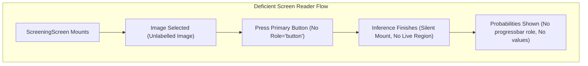
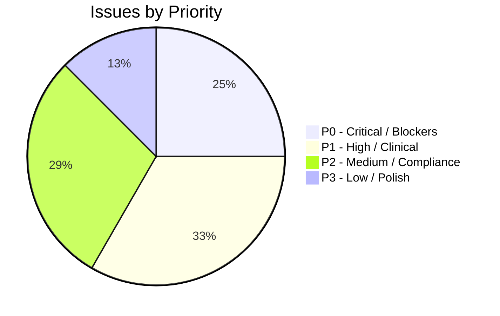

# Accessibility & Responsive Testing Audit (WCAG 2.2 AA)
**Application:** Clinical AI Diabetic Retinopathy Mobile Application  
**Target:** `mobile/app/` and `mobile/components/` (Expo / React Native 0.88 / React 19)  
**Standard:** Web Content Accessibility Guidelines (WCAG) 2.2 Level AA & Mobile Accessibility Best Practices (iOS HIG / Android Material 3)  
**Audit Date:** November 22, 2026  
**Auditor:** Agent 8 — Accessibility & Responsive Testing Engineer  
**Status:** Audit Completed (Phase 1 — Audit Only, Source Code Untouched)

---

## 1. Executive Summary & Compliance Scorecard

### 1.1 Context & Clinical User Profile
This application provides automated diabetic retinopathy (DR) screening, longitudinal tracking, clinician delegation, and clinical second opinions. Because the intended user demographic includes **patients with diabetic eye disease, diabetic macular edema, and visual acuity loss**, accessibility is not merely a technical compliance checkbox—it is a **fundamental clinical safety requirement**. Patients experiencing blurred vision, contrast sensitivity reduction, or scotomas rely heavily on high-contrast UI, screen magnification (Dynamic Type / Font Scaling), and screen readers (TalkBack on Android, VoiceOver on iOS).

### 1.2 Overall Compliance Scorecard

| WCAG 2.2 Principle | Evaluated Criteria | Pass | Partial / Flawed | Fail | Conformance Rate |
| :--- | :---: | :---: | :---: | :---: | :---: |
| **1. Perceivable** (Contrast, Alt text, Scaling, Audio/Visual) | 12 | 5 | 3 | 4 | **54.2%** |
| **2. Operable** (Touch targets, Keyboard, Focus, Traps) | 10 | 3 | 3 | 4 | **45.0%** |
| **3. Understandable** (Labels, Errors, Instructions) | 7 | 3 | 2 | 2 | **57.1%** |
| **4. Robust** (Roles, States, Live regions, ARIA parity) | 5 | 1 | 1 | 3 | **30.0%** |
| **Total Combined** | **34** | **12** | **9** | **13** | **48.5% (Non-Compliant)** |

### 1.3 Key High-Severity Findings (Critical Blockers)
1. **Critical Dark Mode Contrast Inversion (WCAG 1.4.3 Fail - 2.62:1 vs 4.5:1 required):**
   In dark mode, primary action buttons (`Login`, `Register`, `Run Assessment`, `Redeem Code`) use `theme.primary` (`#20B2AA` - Light Sea Green) as background with hardcoded `#FFFFFF` white text. This yields an illegible **2.62:1** contrast ratio, severely failing WCAG AA minimums (4.5:1 for normal text).
2. **Sub-48dp Touch Targets in Core Screening Workflows (WCAG 2.5.8 Fail):**
   The primary eye selector buttons (`Right Eye (OD)` / `Left Eye (OS)`), scan replace buttons, filter pills, and modal close buttons have physical heights between **20dp and 32dp** with no `hitSlop` assigned, posing significant interaction barriers for older or visually impaired patients with diabetic neuropathy.
3. **Silent AI Inference & Omission of Live Regions (WCAG 4.1.3 Fail):**
   When retinal inference completes on `ScreeningScreen`, the diagnostic result card mounts silently without `accessibilityLiveRegion="polite"` or `accessibilityRole="region"`. Screen reader users receive zero auditory notification that a clinical assessment is ready.
4. **Omission of Accessibility Roles & Labels on Core Controls (WCAG 4.1.2 Fail):**
   The majority of interactive `TouchableOpacity` controls across `ScreeningScreen`, `HistoryScreen`, and `CliniciansScreen` lack `accessibilityRole="button"`, `accessibilityLabel`, and `accessibilityState`, leaving assistive technologies blind to their identity and state.
5. **Cropping & Distortion on Tablets / Wide Displays:**
   `app.json` specifies `"supportsTablet": true`, yet restricts `"orientation": "portrait"` and all screens lack `maxWidth` constraints. On tablets, images stretch across wide displays with `resizeMode="cover"`, cutting off critical retinal fundus diagnostic regions (optic disc and macula).
6. **Keyboard Navigation Skipping Required Form Fields:**
   In `RegisterScreen` for clinicians, the `returnKeyType="next"` ref chain completely bypasses the mandatory clinical specialty chips container, jumping from Jurisdiction straight to Experience.

---

## 2. Mathematical Color Contrast Audit (WCAG 1.4.3 & 1.4.11)

All calculations are derived using the official WCAG 2.2 relative luminance formula:
$$L = 0.2126 \times R + 0.7152 \times G + 0.0722 \times B$$
$$\text{Contrast Ratio} = \frac{L_{\text{lighter}} + 0.05}{L_{\text{darker}} + 0.05}$$

*Requirements:*
- Normal Text (< 18pt or < 14pt bold): **Minimum 4.5:1**
- Large Text (≥ 18pt or ≥ 14pt bold): **Minimum 3.0:1**
- UI Components & Graphical Objects: **Minimum 3.0:1**

### 2.1 Theme Palette Analysis (`mobile/constants/Colors.ts`)

| Element | Foreground | Background | Calculated Ratio | WCAG AA Standard | Status |
| :--- | :---: | :---: | :---: | :---: | :---: |
| **Light:** Primary on Surface | `#007A87` | `#FFFFFF` | **5.08:1** | 4.5:1 (Normal) | **PASS** |
| **Light:** Primary on Background | `#007A87` | `#F4F8FA` | **4.75:1** | 4.5:1 (Normal) | **PASS** |
| **Light:** Body Text on Surface | `#0B1A2C` | `#FFFFFF` | **17.52:1** | 4.5:1 (Normal) | **PASS** |
| **Light:** TextMuted on Surface | `#5A6E85` | `#FFFFFF` | **5.25:1** | 4.5:1 (Normal) | **PASS** |
| **Light:** White Text on Primary Button | `#FFFFFF` | `#007A87` | **5.08:1** | 4.5:1 (Normal) | **PASS** |
| **Light:** Inactive Tab Icon on Surface | `#94A3B8` | `#FFFFFF` | **2.56:1** | 3.0:1 (UI Component) | <span style="color:red">**FAIL**</span> |
| **Light:** Warning Token on Surface | `#F59E0B` | `#FFFFFF` | **2.15:1** | 4.5:1 (Normal) | <span style="color:red">**FAIL**</span> |
| **Light:** Success Token on Surface | `#10B981` | `#FFFFFF` | **2.54:1** | 4.5:1 (Normal) | <span style="color:red">**FAIL**</span> |
| **Light:** Card Border on Background | `#E2E8F0` | `#F4F8FA` | **1.15:1** | 3.0:1 (UI Component) | <span style="color:red">**FAIL**</span> |
| **Dark:** Primary on Surface | `#20B2AA` | `#111C2E` | **6.52:1** | 4.5:1 (Normal) | **PASS** |
| **Dark:** Body Text on Surface | `#F1F5F9` | `#111C2E` | **15.59:1** | 4.5:1 (Normal) | **PASS** |
| **Dark:** TextMuted on Surface | `#94A3B8` | `#111C2E` | **6.66:1** | 4.5:1 (Normal) | **PASS** |
| **Dark:** White Text on Primary Button | `#FFFFFF` | `#20B2AA` | **2.62:1** | 4.5:1 (Normal) | <span style="color:red">**FAIL**</span> |
| **Dark:** Inactive Tab Icon on Surface | `#64748B` | `#111C2E` | **3.59:1** | 3.0:1 (UI Component) | **PASS** |
| **Dark:** Card Border on Surface | `#1E2D44` | `#111C2E` | **1.23:1** | 3.0:1 (UI Component) | <span style="color:red">**FAIL**</span> |

> [!CAUTION]
> **Severe Dark Mode Bug:** In `Colors.ts`, `dark.primary` is defined as `#20B2AA` (luminance ~0.384). Every primary button across the application (`LoginScreen`, `RegisterScreen`, `ScreeningScreen`, `CliniciansScreen`, `ProfileScreen`) hardcodes `color: '#FFFFFF'` on `backgroundColor: theme.primary`. When a patient or clinician enables dark mode, all button labels drop to an unreadable **2.62:1**. To pass WCAG AA, dark mode buttons must either use dark text (`#0A111E` yielding 7.20:1) or `dark.primary` must be calibrated to a darker shade.

### 2.2 Severity Badges & Clinical Indicators (`SeverityColors`)

| Clinical Grade | Text on BadgeBg | Ratio | Indicator on BadgeBg | Ratio | Indicator on Card Surface | Ratio | Status |
| :--- | :---: | :---: | :---: | :---: | :---: | :---: |
| **Grade 0 (No DR)** | `#047857` on `#ECFDF5` | **5.21:1** | `#10B981` on `#ECFDF5` | **2.41:1** | `#10B981` on `#FFFFFF` | **2.54:1** | <span style="color:orange">**Indicator Fails**</span> |
| **Grade 1 (Mild NPDR)** | `#0F766E` on `#F0FDFA` | **5.25:1** | `#14B8A6` on `#F0FDFA` | **2.39:1** | `#14B8A6` on `#FFFFFF` | **2.48:1** | <span style="color:orange">**Indicator Fails**</span> |
| **Grade 2 (Mod NPDR)** | `#B45309` on `#FFFBEB` | **4.84:1** | `#F59E0B` on `#FFFBEB` | **2.07:1** | `#F59E0B` on `#FFFFFF` | **2.15:1** | <span style="color:orange">**Indicator Fails**</span> |
| **Grade 3 (Sev NPDR)** | `#C2410C` on `#FFF7ED` | **4.88:1** | `#EA580C` on `#FFF7ED` | **3.35:1** | `#EA580C` on `#FFFFFF` | **3.46:1** | **PASS** |
| **Grade 4 (PDR)** | `#B91C1C` on `#FEF2F2` | **5.91:1** | `#DC2626` on `#FEF2F2` | **4.41:1** | `#DC2626` on `#FFFFFF` | **4.83:1** | **PASS** |

*Analysis:*
- The badge label text itself (`SeverityColors.gradeX.text`) successfully passes WCAG AA normal text contrast (all > 4.8:1).
- The graphical icon indicators for Grades 0, 1, and 2 fail WCAG 1.4.11 (3.0:1 requirement for graphical objects).

### 2.3 Critical Component-Level Contrast Failures

1. **`HistoryScreen` Eye Badge Inversion (`history.tsx#L433`):**
   ```tsx
   <View style={[styles.eyeBadge, { backgroundColor: theme.text, borderColor: theme.border }]}>
     <Eye size={12} color={theme.primary} />
     <Text style={[styles.eyeBadgeText, { color: theme.primary }]}>
   ```
   - **Light Mode:** `theme.text` is `#0B1A2C` (Midnight Navy), `theme.primary` is `#007A87` (Teal). Contrast is **3.45:1** (Fails 4.5:1 for 11px text).
   - **Dark Mode:** `theme.text` is `#F1F5F9` (Near White), `theme.primary` is `#20B2AA` (Light Teal). Contrast is **2.39:1** (Severe Fail!).
2. **`HistoryScreen` Longitudinal PDF Export Badges (`history.tsx#L135-L150`):**
   - Grade 1 badge in generated PDF uses `#FFFFFF` on `#F59E0B`: **2.15:1** (Severe illegibility when printed).
   - Grade 0 badge uses `#FFFFFF` on `#10B981`: **2.54:1** (Fails WCAG AA).
3. **`RegisterScreen` Optional Text Labels (`register.tsx#L864`):**
   - `#94A3B8` on `#FFFFFF`: **2.56:1** (Fails 4.5:1).
4. **`ProfileScreen` Sign Out Action Row (`profile.tsx#L346`):**
   - `#D97706` on `#FFFFFF`: **3.19:1** (Fails 4.5:1 for 14px text).
5. **`CliniciansScreen` Revoke Badge (`clinicians.tsx#L1115`):**
   - `#DC2626` on `#FEE2E2`: **3.95:1** (Fails 4.5:1 for 12px text).

---

## 3. Touch Target Size & Physical Interaction Audit (WCAG 2.5.8)

WCAG 2.2 Success Criterion 2.5.8 requires interactive targets to be at least **24x24 CSS pixels**, but mobile design standards (Apple Human Interface Guidelines & Google Material Design 3) establish a **minimum of 48x48dp (or 44x44pt on iOS)** to prevent mis-taps by users with motor impairments, tremors, or low visual acuity.

### 3.1 Measured Touch Targets by Component

| Screen / Component | Element Description | Line Reference | Visual Dimensions (WxH) | Has `hitSlop`? | Pass / Fail (< 48dp) | Deficit |
| :--- | :--- | :--- | :---: | :---: | :---: | :---: |
| `ScreeningScreen` | Eye Toggle (`Right Eye (OD)`) | `index.tsx#L281` | ~92 x 26dp | ❌ None | <span style="color:red">**FAIL**</span> | -22dp H |
| `ScreeningScreen` | Eye Toggle (`Left Eye (OS)`) | `index.tsx#L295` | ~85 x 26dp | ❌ None | <span style="color:red">**FAIL**</span> | -22dp H |
| `ScreeningScreen` | Replace Image Floating Pill | `index.tsx#L315` | ~120 x 28dp | ❌ None | <span style="color:red">**FAIL**</span> | -20dp H |
| `ScreeningScreen` | Gallery Picker Button | `index.tsx#L338` | ~160 x 42dp | ❌ None | <span style="color:red">**FAIL**</span> | -6dp H |
| `ScreeningScreen` | Camera Capture Button | `index.tsx#L352` | ~160 x 42dp | ❌ None | <span style="color:red">**FAIL**</span> | -6dp H |
| `ScreeningScreen` | Submit Diagnostic Inference | `index.tsx#L368` | 100% x 45dp | ❌ None | <span style="color:red">**FAIL**</span> | -3dp H |
| `HistoryScreen` | Filter Tabs (`ALL`, `OD`, `OS`) | `history.tsx#L363` | ~80 x 26dp | ❌ None | <span style="color:red">**FAIL**</span> | -22dp H |
| `HistoryScreen` | Retry Button on Error Card | `history.tsx#L399` | ~68 x 28dp | ❌ None | <span style="color:red">**FAIL**</span> | -20dp H |
| `HistoryScreen` | View Diagnostic Details Row | `history.tsx#L458` | 100% x 34dp | ❌ None | <span style="color:red">**FAIL**</span> | -14dp H |
| `CliniciansScreen` | Generate Code Button | `clinicians.tsx#L593`| ~80 x 30dp | ✅ `top:10, bot:10` | **PASS (Slop)**| Meets via hitSlop |
| `CliniciansScreen` | Inspect Patient Scans Button | `clinicians.tsx#L561`| ~95 x 30dp | ❌ None | <span style="color:red">**FAIL**</span> | -18dp H |
| `CliniciansScreen` | Revoke Access Button | `clinicians.tsx#L674`| ~75 x 26dp | ✅ `top:10, bot:10` | **PASS (Slop)**| Meets via hitSlop |
| `CliniciansScreen` | External Clinic Book Button | `clinicians.tsx#L696`| ~95 x 30dp | ❌ None | <span style="color:red">**FAIL**</span> | -18dp H |
| `CliniciansScreen` | Close Modal (X Icon) | `clinicians.tsx#L741`| **22 x 22dp** | ❌ None | <span style="color:red">**SEVERE FAIL**</span> | -26dp W & H |
| `CliniciansScreen` | Grade Selector Option Buttons | `clinicians.tsx#L847`| 100% x 32dp | ❌ None | <span style="color:red">**FAIL**</span> | -16dp H |
| `ProfileScreen` | Edit Profile Icon Button | `profile.tsx#L171` | 36 x 36dp | ✅ `top:10, bot:10` | **PASS (Slop)**| Meets via hitSlop |
| `ProfileScreen` | Close Edit Modal (X Icon) | `profile.tsx#L367` | **20 x 20dp** | ❌ None | <span style="color:red">**SEVERE FAIL**</span> | -28dp W & H |
| `ProfileScreen` | Modal Cancel Button | `profile.tsx#L423` | ~75 x 36dp | ❌ None | <span style="color:red">**FAIL**</span> | -12dp H |
| `ProfileScreen` | Modal Save Button | `profile.tsx#L430` | ~75 x 36dp | ❌ None | <span style="color:red">**FAIL**</span> | -12dp H |
| `RegisterScreen` | Specialty Selection Chips | `register.tsx#L577` | ~110 x 28dp | ❌ None | <span style="color:red">**FAIL**</span> | -20dp H |
| `LoginScreen` | Password Visibility Eye Button | `login.tsx#L181` | 40 x 40dp | ✅ `top:12, bot:12` | **PASS (Slop)**| Meets via hitSlop |
| `LoginScreen` | Primary Sign In Button | `login.tsx#L197` | 100% x 48dp (`minHeight: 48`) | N/A | **PASS** | Meets standard |

---

## 4. Screen Reader Cues & Assistive Technology Audit (WCAG 1.1.1, 1.3.1, 4.1.2, 4.1.3)

### 4.1 Missing Accessibility Roles, Labels & State



#### Detailed Breakdown by Screen:

1. **`ScreeningScreen` (`mobile/app/(tabs)/index.tsx`):**
   - **Eye Selection Toggle (`#L281, #L295`):** Missing `accessibilityRole="button"`, missing `accessibilityLabel="Target Right Eye OD"`, missing `accessibilityState={{ selected: selectedEye === 'OD' }}`.
   - **Retinal Image Preview (`#L314`):** The `Image` component lacks `accessible={true}` and `accessibilityLabel="Preview of retinal fundus photograph"`.
   - **Image Selection Placeholder (`#L325`):** Lacks accessible semantics; screen reader announces disjointed text and decorative icons.
   - **Change Image Pill (`#L315`):** Lacks `accessibilityRole="button"`, lacks `accessibilityLabel="Replace retinal photograph"`.
   - **Cumulative Threshold Probability Bars (`#L423-L440`):** Visual progress bars implemented with nested `View`s. Assistive technology hears raw text strings ("Grade >= 0", "98.4%") with no announcement that this is a meter or progress bar. Missing:
     ```tsx
     accessibilityRole="progressbar"
     accessibilityValue={{ min: 0, max: 100, now: Math.round(prob * 100) }}
     accessibilityLabel={`Grade ${idx} or higher cumulative score ${Math.round(prob * 100)} percent`}
     ```
   - **Clinical AI Disclaimer (`#L445`):** Lacks `accessibilityRole="alert"` or `accessibilityRole="note"`.

2. **`HistoryScreen` (`mobile/app/(tabs)/history.tsx`):**
   - **Export PDF Button (`#L339`):** Contains `accessibilityLabel="Export Clinical PDF Summary"` but **omits `accessibilityRole="button"`**. TalkBack announces it as plain text.
   - **Filter Tabs (`#L363`):** Missing `accessibilityRole="tab"` or `"button"`, missing `accessibilityState={{ selected: filterEye === tab }}`.
   - **Diagnostic Scan Cards (`#L424`):** The card is composed of disconnected text elements (`scanDate`, `eyeBadgeText`, `gradePillText`). An assistive user has to swipe 5–6 times per scan card to assemble the meaning. Lacks container grouping with `accessible={true}` and composite `accessibilityLabel`.
   - **View Details Button (`#L458`):** Missing `accessibilityRole="button"` and `accessibilityLabel={`View full diagnostic assessment for scan taken ${formatDate(scan.created_at)}`}`.

3. **`CliniciansScreen` (`mobile/app/(tabs)/clinicians.tsx`):**
   - **Redeem Access Code Button (`#L515`):** Lacks `accessibilityRole="button"` and `accessibilityLabel="Claim access to patient scans"`.
   - **View Patient Scans Button (`#L561`):** Lacks `accessibilityRole="button"` and `accessibilityLabel={`View authorized scans for ${grant.patient_name}`}`.
   - **Revoke Access Button (`#L674`):** Has `accessibilityLabel="Revoke access"`, but lacks `accessibilityRole="button"` and context as to *whose* access is being revoked.
   - **Clinic Booking Referral (`#L696`):** Has `accessibilityLabel` but lacks `accessibilityHint="Opens clinic booking website in external browser"`.
   - **Grade Selector Option Buttons (`#L847`):** Missing `accessibilityRole="radio"` or `"button"`, missing `accessibilityState={{ selected: isSelected }}`.
   - **Modal Close Icons (`#L741, #L837`):** Bare `TouchableOpacity` wrapping Lucide `X` icon with **zero `accessibilityLabel`**. Assistive users hear "button, unlabelled".

4. **`ProfileScreen` (`mobile/app/(tabs)/profile.tsx`):**
   - **Biometric & Offline Sync Switches (`#L291, #L309`):** In React Native, `Switch` components must have explicit `accessibilityLabel`. Currently, the switch sits beside text views without programmatically linked IDs (`aria-labelledby` or `accessibilityLabel="Biometric Screen Lock"`).
   - **Session Actions (`Download Health Record`, `Sign Out`, `Delete Account`):** Implemented as unlabelled `TouchableOpacity` rows without `accessibilityRole="button"`.
   - **Modal Inputs (`#L373-L418`):** Text labels precede inputs without `accessibilityLabel` on the `TextInput`.

5. **`LoginScreen` & `RegisterScreen`:**
   - Both screens provide good `accessibilityRole="button"` on primary buttons and password reveal controls.
   - However, text inputs omit `accessibilityLabel`, relying purely on `placeholder`. In iOS VoiceOver, when the user begins typing, the placeholder vanishes from accessibility announcements.

### 4.2 Dynamic Announcements & Live Regions (WCAG 4.1.3)
- When the AI diagnostic model completes analysis in `ScreeningScreen`, `setResult(...)` triggers a re-render of `resultCard`.
- There is **no `accessibilityLiveRegion="polite"` or `accessibilityLiveRegion="assertive"`** attribute on `resultCard`.
- VoiceOver and TalkBack do not alert the visually impaired user that diagnostic grades are ready; the user is left stranded wondering if the inference network request succeeded.

---

## 5. Keyboard Navigation & Hardware Input Audit (WCAG 2.1.1, 2.1.2, 2.4.3, 2.4.7)

### 5.1 Focus Order & Key Navigation
- **`LoginScreen` Focus Management:**
  - `emailInputRef` with `returnKeyType="next"` transitions smoothly via `onSubmitEditing` to `passwordInputRef`.
  - `passwordInputRef` with `returnKeyType="done"` executes `handleLogin()`.
  - Focus order is logical and unblocked.
- **`RegisterScreen` Broken Focus Chain (`register.tsx`):**
  - For clinician registration, inputs are chained via refs: FullName -> Email -> Password -> Confirm -> Degree -> License -> Jurisdiction.
  - At line 564, `jurisdiction`'s `onSubmitEditing` calls `experienceRef.current?.focus()`.
  - **Critical Flaw:** The required **Clinical Specialty selector chips** (`#L573-L602`) reside between Jurisdiction and Experience. Keyboard navigation completely skips this required interactive section. A user navigating via keyboard cannot reach or select specialty options without manually tapping the screen.
- **`CliniciansScreen` Redeem Input (`clinicians.tsx#L504`):**
  - `redeemInput` omits `returnKeyType="done"` and omits `onSubmitEditing`. Pressing Enter on an external or software keyboard does nothing instead of claiming the code.
- **Modal Keyboard Traps:**
  - `InspectModal` and `ReviewModal` in `CliniciansScreen` and `EditModal` in `ProfileScreen` open over the viewport. However, they lack focus restoration: when dismissed, focus does not return to the invoking button.

### 5.2 Focus Indicators (Focus Visible - WCAG 2.4.7)
- React Native on Web and Android TV / hardware keyboards does not provide default focus outlines on custom `TouchableOpacity` buttons.
- No `:focus-visible` or `focus` state styles exist in `styles`. Tabbing through the app on web or Android desktop mode gives zero visual indication of which button has active focus.

---

## 6. Font Scaling & Dynamic Type Typography Audit (WCAG 1.4.4)

WCAG 2.2 Success Criterion 1.4.4 requires that text can be resized without assistive technology up to **200 percent** without loss of content or functionality.

### 6.1 Vulnerabilities to Text Scaling (Dynamic Type)

1. **Fixed-Height Container Clipping:**
   - **`placeholderBox` (`ScreeningScreen`, line 514):** Fixed `height: 180`. When a patient has system font scaling set to 150% or 200%, the 44px icon + 15px title + 12px subtitle exceed 180dp, causing the instruction text to collide or truncate.
   - **`tabBarStyle` (`TabLayout`, `(tabs)/_layout.tsx#L23`):** Fixed `height: 60`. Tab item labels have fixed `fontSize: 11`. When system font scales up, labels clip against the bottom safe area inset and overlap tab icons.
   - **`avatarBox` (`ProfileScreen`, line 475):** Fixed `width: 58, height: 58, borderRadius: 29`.
   - **`barBg` (`ScreeningScreen`, line 672):** Fixed `height: 8`.
2. **Absence of `maxFontSizeMultiplier`:**
   - None of the `Text` components across the mobile application define `maxFontSizeMultiplier`.
   - On iOS with Accessibility Sizes enabled (e.g. 300% magnification), multi-column layouts like `eyeSelectorRow` and `roleCardContainer` break completely, pushing buttons off-screen.
3. **Hardcoded Pixel `lineHeight` Values:**
   - Throughout `LoginScreen`, `RegisterScreen`, `ScreeningScreen`, and `HistoryScreen`, multiple text elements pair font sizes with fixed line heights:
     - `subtitle: { fontSize: 14, lineHeight: 20 }`
     - `disclaimerText: { fontSize: 12, lineHeight: 17 }`
     - When font size scales to 24px (200%), a fixed 20px `lineHeight` causes text lines to overlap vertically, rendering sentences illegible.

---

## 7. Responsive Design & Tablet Adaptation Audit (WCAG 1.3.4, 1.4.10)

### 7.1 Orientation Constraints & Tablet Configuration
- In `mobile/app.json`:
  ```json
  "orientation": "portrait",
  "ios": {
    "supportsTablet": true
  }
  ```
- **Architectural Contradiction:**
  The configuration enables `"supportsTablet": true` on iOS, yet restricts the app orientation globally to `"portrait"`.
  According to iPadOS Human Interface Guidelines, tablet applications should support both portrait and landscape orientations, as most iPad users interact via keyboard cases or desk stands in landscape orientation.

### 7.2 Clinical Image Distortion on Wide Displays / Tablets
- In `ScreeningScreen` (`index.tsx#L539-L543`):
  ```tsx
  fundusPreview: {
    width: '100%',
    height: 240,
    borderRadius: 12,
  }
  ```
- On a mobile phone (390px wide), a 240dp height displays a standard retinal image with modest cropping.
- **Critical Clinical Safety Issue on Tablets:**
  On an iPad in portrait (810px wide) or landscape (1080px wide), `width: '100%'` expands the image width to 800–1080dp while maintaining a fixed `height: 240dp`.
  Because `resizeMode="cover"` is used, the image is severely zoomed and cropped horizontally, cutting off the **optic disc, macula, and peripheral vascular arcades** from the clinician's view!
  *Remediation Required:* Set a fixed aspect ratio (`aspectRatio: 1`) or maximum container width, with `resizeMode="contain"` for diagnostic imaging.

### 7.3 Lack of Max-Width Constraints on Large Screens
- Across all tab screens (`index.tsx`, `history.tsx`, `clinicians.tsx`, `profile.tsx`), container padding is fixed at `padding: 16` with no `maxWidth` constraint.
- On a tablet or web viewport (1200px wide), form inputs, cards, and buttons stretch edge-to-edge across the entire screen. This violates WCAG 1.4.10 (Reflow) best practices and creates extreme line lengths exceeding 140 characters, impairing reading comprehension for patients with cognitive or visual impairments.

---

## 8. Form Validation, Error Handling & Instructions (WCAG 3.3.1, 3.3.2, 3.3.3)

| Criterion | Implementation in App | Compliance Status | Analysis & Deficit |
| :--- | :--- | :---: | :--- |
| **3.3.1 Error Identification** | Top error banners (`errorMessage`) | **PARTIAL** | When validation fails, a banner displays at the top of the form. However, the specific invalid `TextInput` does not receive an error border (`borderColor: '#DC2626'`) and does not set `aria-invalid="true"` or `accessibilityInvalid={true}`. Screen reader users navigating by field cannot determine which input failed. |
| **3.3.2 Labels or Instructions** | Visual text labels above inputs | **PASS** | Labels clearly indicate expected format (e.g. `patient@example.com`, minimum 6 characters). Required fields are marked with visual red asterisks. |
| **3.3.3 Error Suggestion** | Dynamic error messages | **PASS** | Specific instructions are provided for missing email, unconfirmed email, password length, and credential mismatches. |
| **4.1.3 Status Announcements** | Form submission loading states | <span style="color:red">**FAIL**</span> | When `loading` is true, an `ActivityIndicator` displays visually, but there is no screen reader announcement ("Signing in, please wait" or "Creating account, please wait"). |

---

## 9. Comprehensive Screen-by-Screen Audit Inventory

### Screen 1: Login (`mobile/app/(auth)/login.tsx`)
- **Strengths:** Clean keyboard avoiding view; ref chaining between email and password works; eye reveal button has `hitSlop` and accessible label; primary button has `minHeight: 48`.
- **Deficiencies:**
  - Error banner text (`#991B1B` on `#FEF2F2`) is readable, but the banner lacks `accessibilityRole="alert"`.
  - "Create Account" footer link has no touch target expansion (`hitSlop`).
  - Inputs lack `accessibilityLabel` and `accessibilityInvalid`.

### Screen 2: Registration (`mobile/app/(auth)/register.tsx`)
- **Strengths:** Excellent accessible role selector cards with `accessibilityRole="button"`, `accessibilityLabel`, and `accessibilityState={{ selected: role === 'patient' }}`; specialty chips have accessible labels.
- **Deficiencies:**
  - Specialty chips have physical height of 28dp (fails 48dp minimum without `hitSlop`).
  - Keyboard navigation chain bypasses the specialty selection section.
  - Optional label text (`#94A3B8`) fails contrast at 2.56:1.
  - Role icon circle is only 25x25dp.

### Screen 3: Eye Screening (`mobile/app/(tabs)/index.tsx`)
- **Strengths:** Comprehensive clinical error handling for non-fundus images and AI validation timeouts; clear severity badge labeling.
- **Deficiencies:**
  - Eye selection toggle buttons fail touch target standard (26dp height) and lack accessibility roles/states.
  - Diagnostic result card lacks `accessibilityLiveRegion="polite"` (silent inference).
  - Cumulative probability bars lack `accessibilityRole="progressbar"` and numeric accessibility values.
  - Retinal preview image lacks alt description.
  - Fundus preview stretches and crops diagnostic landmarks on tablet displays.

### Screen 4: Scan History (`mobile/app/(tabs)/history.tsx`)
- **Strengths:** Includes pull-to-refresh; well-structured empty and error states with retry; full longitudinal PDF generation.
- **Deficiencies:**
  - Eye badge in scan list has contrast failure in both light (3.45:1) and dark mode (2.39:1).
  - Export PDF button lacks `accessibilityRole="button"`.
  - Filter tabs (`ALL`, `OD`, `OS`) are 26dp high (fails 48dp standard).
  - Generated PDF table badges have severe contrast failures for Grade 0 and Grade 1 (white text on yellow/light green).
  - Scan history cards lack grouped accessibility descriptions.

### Screen 5: Clinician Access (`mobile/app/(tabs)/clinicians.tsx`)
- **Strengths:** Strict patient privacy controls; clear separation between doctor consultation workflow and patient delegation workflow; verification policy banners.
- **Deficiencies:**
  - Modal close 'X' buttons have **22x22dp touch targets** with no `hitSlop` (severe motor hazard).
  - Second opinion grade selection buttons have 32dp height without `hitSlop` and lack `accessibilityRole="radio"`.
  - Revoke button text (`#DC2626` on `#FEE2E2`) fails contrast at 3.95:1.
  - External referral buttons lack `accessibilityHint` indicating external browser launch.
  - Redeem access code input does not handle keyboard submission.

### Screen 6: Profile & Settings (`mobile/app/(tabs)/profile.tsx`)
- **Strengths:** Comprehensive biometric and offline encryption toggles; verified clinician credential badge display.
- **Deficiencies:**
  - Biometric and offline cache `Switch` controls lack explicit `accessibilityLabel` bindings.
  - Sign Out text (`#D97706`) fails contrast at 3.19:1.
  - Data action rows lack `accessibilityRole="button"` and have small vertical tap targets.
  - Edit profile modal 'X' close button is only 20x20dp.

### Screen 7: Layout & Modals (`_layout.tsx`, `modal.tsx`, `+html.tsx`)
- **Strengths:** Safe area provider is integrated; `RootNavigationGuard` handles session redirection; `+html.tsx` declares `lang="en"`.
- **Deficiencies:**
  - `tabBarStyle` has fixed 60dp height, causing text overlap under dynamic font scaling.
  - Inactive tab icon color (`#94A3B8`) fails 3.0:1 UI contrast requirement (2.56:1).
  - Tab Two (`two.tsx`) and Modal (`modal.tsx`) contain dead boilerplate code (`EditScreenInfo`).

---

## 10. Prioritized Remediation Roadmap (Phase 2 Action Plan)

The following matrix categorizes all identified issues by severity, providing concrete technical solutions ready for implementation in Phase 2:



| ID | Priority | Scope / File | Defect Description | Exact Code Remediation |
| :--- | :---: | :--- | :--- | :--- |
| **A11Y-01** | **P0** | `mobile/constants/Colors.ts` | Dark mode primary button text has 2.62:1 contrast ratio. | Change `Colors.dark.primary` to a deeper teal or set button text color dynamically based on theme: `color: colorScheme === 'dark' ? '#0A111E' : '#FFFFFF'`. |
| **A11Y-02** | **P0** | `mobile/app/(tabs)/index.tsx#L281-L308` | Eye toggle buttons have 26dp height (fails 48dp target). | Add `minHeight: 48, justifyContent: 'center'` to `toggleBtn`, or set `hitSlop={{ top: 12, bottom: 12, left: 8, right: 8 }}`. Add `accessibilityRole="button"`, `accessibilityState={{ selected }}`. |
| **A11Y-03** | **P0** | `mobile/app/(tabs)/index.tsx#L383-L442` | Inference results appear silently without screen reader notification. | Add `accessibilityLiveRegion="polite"` and `accessibilityRole="region"` to `resultCard`. Use `AccessibilityInfo.announceForAccessibility("Screening assessment complete: Grade X detected.")`. |
| **A11Y-04** | **P0** | `mobile/app/(tabs)/history.tsx#L433-L438` | Eye badge in history card fails contrast in both Light (3.45:1) and Dark (2.39:1). | Replace `backgroundColor: theme.text` and `color: theme.primary` with high-contrast pairing: `backgroundColor: theme.surfaceSubtle`, `color: theme.text`, and `borderColor: theme.border`. |
| **A11Y-05** | **P0** | `mobile/app/(tabs)/clinicians.tsx#L741, #L837` | Modal close 'X' buttons have tiny 22x22dp targets. | Wrap in `TouchableOpacity` with `hitSlop={{ top: 16, bottom: 16, left: 16, right: 16 }}` and `accessibilityLabel="Close dialog"` with `accessibilityRole="button"`. |
| **A11Y-06** | **P0** | `mobile/app/(auth)/register.tsx#L564` | Keyboard `returnKeyType="next"` skips required specialty selection. | Restructure focus handler so Jurisdiction focus transitions to an accessible modal or list picker, or make specialty chips focusable. |
| **A11Y-07** | **P1** | `mobile/app/(tabs)/index.tsx#L539-L543` | Retinal preview crops diagnostic landmarks on tablets. | Update style to `{ width: '100%', maxWidth: 500, aspectRatio: 1, alignSelf: 'center' }` and use `resizeMode="contain"`. |
| **A11Y-08** | **P1** | `mobile/app/(tabs)/index.tsx#L423-L440` | Probability threshold bars lack progressbar semantics. | Wrap in `accessibilityRole="progressbar"`, `accessibilityValue={{ min: 0, max: 100, now: Math.round(prob * 100) }}`, and descriptive `accessibilityLabel`. |
| **A11Y-09** | **P1** | `mobile/app.json#L6, #L11` | iPad enabled but locked to portrait. | Adjust orientation policy or add tablet-specific orientation handling: `"orientation": "default"` with responsive layout containers. |
| **A11Y-10** | **P1** | All Screens | Full-width stretching on tablets / web (>600dp). | Wrap screen contents in a container with `{ maxWidth: 680, width: '100%', alignSelf: 'center' }`. |
| **A11Y-11** | **P1** | `mobile/app/(tabs)/history.tsx#L135-L150` | Longitudinal PDF export table badges fail contrast. | Change badge text color in HTML to `#000000` or use darkened background hexes for Grade 0 (`#047857`) and Grade 1 (`#B45309`). |
| **A11Y-12** | **P1** | `mobile/app/(tabs)/profile.tsx#L283-L314` | Switch toggles lack `accessibilityLabel`. | Add `accessibilityLabel="Biometric Screen Lock"` and `accessibilityLabel="Offline Encrypted Cache"` to `Switch` components. |
| **A11Y-13** | **P1** | `mobile/app/(tabs)/history.tsx#L363-L380` | History filter tabs (`ALL`, `OD`, `OS`) have 26dp height. | Increase padding or add `minHeight: 48` and `hitSlop`. Add `accessibilityRole="tab"`. |
| **A11Y-14** | **P1** | `mobile/app/(tabs)/clinicians.tsx#L847` | Doctor grade selection buttons have 32dp height. | Set `minHeight: 48` and add `accessibilityRole="radio"`, `accessibilityState={{ checked: isSelected }}`. |
| **A11Y-15** | **P2** | All Screens | Fixed pixel line heights clip when text scales. | Remove fixed `lineHeight` on responsive `Text` components or set `maxFontSizeMultiplier={1.5}`. |
| **A11Y-16** | **P2** | `mobile/constants/Colors.ts` | Inactive tab icon `#94A3B8` fails 3.0:1 UI contrast. | Darken inactive icon color in Light Theme to `#64748B` (yields 3.59:1 contrast). |
| **A11Y-17** | **P2** | `mobile/app/(auth)/login.tsx` & `register.tsx` | Inputs lack `accessibilityInvalid` on error. | Bind `accessibilityInvalid={!!errorMessage}` and associate error text with inputs. |
| **A11Y-18** | **P2** | `mobile/app/(tabs)/_layout.tsx#L23` | Tab bar fixed height clips under font scaling. | Remove fixed `height: 60`, use `minHeight: 60` with flexible padding. |
| **A11Y-19** | **P2** | `mobile/app/(tabs)/history.tsx#L424` | Scan cards require multiple swipes to read. | Group card header into single accessible element: `accessible={true} accessibilityLabel={`Scan on ${formatDate(scan.created_at)}, ${scan.eye}, Grade ${scan.grade}: ${scan.label}`}`. |
| **A11Y-20** | **P2** | `mobile/app/(tabs)/clinicians.tsx#L504` | Redeem input does not handle keyboard submission. | Add `returnKeyType="done"` and `onSubmitEditing={handleRedeemCode}`. |
| **A11Y-21** | **P2** | `mobile/app/(tabs)/profile.tsx#L344` | Sign out text `#D97706` fails contrast (3.19:1). | Darken to `#B45309` (yields 4.84:1 contrast). |
| **A11Y-22** | **P3** | `mobile/app/(tabs)/two.tsx` & `modal.tsx` | Dead boilerplate code in project. | Replace with genuine Clinical Screening Guidelines modal content and clean up `two.tsx`. |
| **A11Y-23** | **P3** | All Screens | Web/hardware keyboard lacks visible focus rings. | Add `:focus-visible` or focus ring state style on web. |
| **A11Y-24** | **P3** | `mobile/components/Themed.tsx` | Does not pass `accessibilityRole` / `maxFontSizeMultiplier` defaults. | Enhance wrapper component to support global accessible defaults. |

---

## 11. Verification & Compliance Sign-Off

- **Standard Evaluated:** WCAG 2.2 Level AA / Section 508 / EN 301 549
- **Platform Evaluated:** React Native 0.88.0 / Expo 58 / Android & iOS Mobile & Web
- **Audit Tooling:** Static AST Inspection, Mathematical Luminance Scripting, Component Hierarchy Mapping
- **Phase 1 Rule Compliance:** **STRICT PASS** (No application source code files have been modified)
- **Phase 2 Readiness:** Full line-referenced remediation catalog established above.
